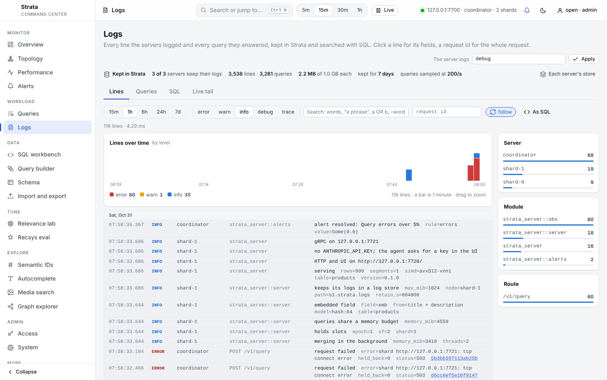

# strata-server
{: .no_toc }

`strata-server` serves a Strata database over HTTP JSON and gRPC, with a browser UI for building queries and an agent that answers questions by writing and running SQL. Run several of them as shards and one more as a coordinator, and the coordinator answers like one database.
{: .fs-5 .fw-300 }

1. TOC
{:toc}

## Run it

```sh
cd strata-server && cargo build --release
target/release/strata-server --demo 20000 --db products.strata   # a demo catalogue
# open http://127.0.0.1:7700
```

`--demo N` creates a product catalogue of *N* rows (titles, descriptions, brands, categories, tags, prices, ratings, sales and a 64-dimension vector) to try things on. Its `emb` field is declared as the `hash:64` model's embedding of the title and description ([below](#embedded-vector-fields)): hashed bags of words, not a learned model, so "similar" means "shares words".

| flag | default | effect |
|---|---|---|
| `--db PATH` | | the database to serve; created if missing, with `--schema` or `--demo` |
| `--schema FILE` | | the schema of a new database, as JSON (below) |
| `--directory` | off | create the new database as a directory of segment files instead of one file |
| `--wal-drop-damaged` | off | open a database whose write-ahead log was damaged after it was durable, dropping the transactions from the damage on (the log is copied to `<log>.damaged` first); without it the server refuses to start on one |
| `--seq-no` | off | number the database's writes, for [conditional writes](#conditional-writes) and `seq_no()`; it cannot be undone, and versions of Strata from before it refuse the database |
| `--replicas URL,URL,…` | | be the [primary](#replication-a-primary-and-its-replicas) of this database: ship its writes to these replicas' gRPC addresses; needs `--seq-no` |
| `--replica` | off | be a [replica](#replication-a-primary-and-its-replicas): apply the writes a primary ships here, and refuse writes from clients; needs `--seq-no` and `--grpc` |
| `--promote` | off | start as the primary of a new term, above every term the database knows, shipping to `--replicas` if any: needed to start a database that was a replica, or whose primary another replaced, as a primary ([promotion](#replication-a-primary-and-its-replicas)) |
| `--write-acks A` | `all` | with `--replicas`: the copies that hold a write before it is answered: `all`, `majority` or `primary` |
| `--ship-log-mb N` | 64 | with `--replicas` or `--replica`: the latest transactions kept in memory to ship; a replica further behind is sent a copy of the primary |
| `--verify-every-s N` | 600 | with `--replicas`: how often each replica's rows are [compared](#replication-a-primary-and-its-replicas) with the primary's; a replica whose rows differ is sent a copy of the primary (0: only when asked, `POST /v1/admin/verify`) |
| `--verify-checksums` | off | check every segment against its checksum before serving (reads the whole database once); a damaged newest version is skipped for the one before it |
| `--shards URL,URL,…` | | run as a coordinator over these shard servers' gRPC addresses |
| `--slot-map FILE` | equal runs, epoch 1 | with `--shards`: the [slot map](#slots) to route writes by, which the shards are given |
| `--listen ADDR` | `127.0.0.1:7700` | HTTP: the API, `/metrics` and the UI |
| `--grpc ADDR` | `127.0.0.1:7701` | gRPC (`off` to disable) |
| `--token T` | `$STRATA_TOKEN` | require `Authorization: Bearer T` on the API and on gRPC; needed to listen beyond loopback ([security](#security)) |
| `--no-token` | off | listen beyond loopback without a token anyway |
| `--allow-host NAME` | | also answer HTTP requests for this host name (repeatable) |
| `--tls-cert FILE`, `--tls-key FILE` | | serve HTTP and gRPC over TLS with this PEM certificate chain and key |
| `--shard-token T` | `$STRATA_SHARD_TOKEN`, else `--token` | a coordinator's token for its shards, and a primary's for its replicas |
| `--shard-ca FILE` | | a CA certificate (PEM) a coordinator trusts for `https://` shards, and a primary for `https://` replicas, besides the public roots |
| `--timeout-ms N` | 5000 | default query deadline |
| `--max-timeout-ms N` | 60000 | the longest deadline a request's `timeout_ms` may ask for |
| `--max-concurrent N` | 64 | queries running at once; more wait for a slot until their deadline |
| `--max-result-window N` | 10000 | the most rows a query may reach, OFFSET included ([limits](#limits)); 0: no limit |
| `--max-groups N` | 65536 | the most groups a GROUP BY may make ([limits](#limits)); 0: no limit |
| `--max-rerank N` | 100 | the most rows a [cross-encoder](query-language.md#cross-encoders-cross_encodermodel-fields-query)'s rerank phase may score, on a database or a coordinator; 0: no limit |
| `--query-memory-mb N` | a third of the cgroup memory limit, or of RAM | memory the running queries may hold together ([limits](#limits)); 0: no limit |
| `--max-queued-writes N` | 1024 | write requests held at once; more are refused with 429 ([limits](#limits)); 0: no limit |
| `--max-body-mb N` | 256 | the largest body of a write or an import, and of a gRPC message; other requests take up to 16 MiB |
| `--model ID` | `claude-haiku-5-5` | the agent's default model |
| `--models DIR` | `$STRATA_MODELS`, else `~/.local/share/strata/models` | where the models of [embedded vector fields](#embedded-vector-fields), [ranking models](query-language.md#ranking-models-gbdtmodel-features) (`<name>/gbdt.json`) and [cross-encoders](query-language.md#cross-encoders-cross_encodermodel-fields-query) (`<name>/config.json`, `tokenizer.json`, `model.safetensors`) are |
| `--copy-from PATH` | | fill the new database (`--db` with `--schema`) with this database's rows, re-embedding the vector fields whose embedding changed |
| `--synonyms FILE` | | the synonym list for `synonyms => 1` searches ([format](query-language.md#typos-and-synonyms)): read at start if it exists, written by `PUT /v1/synonyms` |
| `--backup-dir DIR` | | where `POST /v1/admin/checkpoint` writes checkpoints ([backups](#backups)); created if missing |
| `--media-fetch LIST` | nothing | what writes to [`media` fields](#media-fields) may fetch, comma-separated: `file:/srv/images` (a directory), `cdn.example.com` (HTTPS), `*.example.com`, `http://host:port` |
| `--media-store DIR` | | where files written as bytes are kept, by hash (`media:<sha256>`); created if missing |
| `--media-max-bytes N` | 52428800 (50 MiB) | the largest file a `media` value may name |
| `--media-timeout-s N` | 30 | how long one fetch may take |
| `--log FILTER` | `$STRATA_LOG`, else `info` | what to [log](#logs): a level (`error`, `warn`, `info`, `debug`, `trace`), or levels per module (`info,strata=debug`); `debug` logs every request |
| `--log-format F` | `$STRATA_LOG_FORMAT`, else `text` | log lines as `text` or `json` (one object per line) |
| `--slow-ms N` | 1000 | log queries and writes that take this many milliseconds or more, with their SQL (0: none) |
| `--log-store PATH` | `DB.logs` beside the database; none on a coordinator | the [log store](#the-log-store-logs-kept-in-strata): a Strata database where the server keeps its log lines and queries, searched with SQL; `off` for none |
| `--log-retain PERIOD` | `7 days` | how long the log store keeps a line or a query (`'12h'`, `'2 weeks'`) |
| `--log-store-mb N` | 1024 | the most the log store may take on disk; past it the oldest go |
| `--log-queries N` | 200 | the queries a second the log store keeps of those that ended well and took less than `--slow-ms`; every slow or failed one is kept |
| `--node-name NAME` | `$STRATA_NODE_NAME`, else `HOST:PORT` (the host name and the HTTP port) | what the log store calls this server, in its `node` column |

`strata-server import`, `strata-server fetch-model` and `strata-server promote` are subcommands: [loading rows](#loading-rows), [embedded vector fields](#embedded-vector-fields) and [promotion](#replication-a-primary-and-its-replicas).

## Schemas

A database starts with one table, whose schema is set when the database is created (`--schema FILE`, `strata-server import --schema FILE`, the query console's schema designer, or `strata.Database.create` in [Python](python.md)). [`CREATE TABLE`](query-language.md#tables) and `DROP TABLE` over `POST /v1/sql` add and drop more, and the server serves every table: SQL names its tables, write operations and imports name theirs (`"table"`, `?table=`; the first table when they name none), `GET /v1/tables` lists the schemas and `GET /v1/schema?table=` gives one. [`CREATE RANK PROFILE`](query-language.md#rank-profiles-a-ranking-kept-with-its-table) and `DROP RANK PROFILE` keep rankings with a table the same way; unlike tables, a primary takes them and ships them to its replicas as it ships writes, and answers once the copies its acks name hold them. A schema is JSON: the table's name, its key, and its fields by type, with options only where they differ from the defaults.

```json
{
  "table": "docs",
  "key": "id",
  "fields": [
    {"name": "id", "type": "keyword"},
    {"name": "title", "type": "text"},
    {"name": "body", "type": "text"},
    {"name": "tags", "type": "keyword", "multi": true},
    {"name": "published", "type": "int"},
    {"name": "emb", "type": "vector", "embed": {"from": ["title", "body"], "model": "potion-retrieval-32M"}},
    {"name": "splade", "type": "sparse"}
  ]
}
```

| type | holds | used by |
|---|---|---|
| `text` | words, searched by relevance | `MATCH`, `bm25()` |
| `keyword` | exact values: ids, categories, tags | `=`, `IN`, `GROUP BY` (facets) |
| `int`, `float` | numbers | ranges, sorting, sums, boosts |
| `bool` | true or false | conditions (`WHERE done`), `GROUP BY` |
| `timestamp` | a moment in UTC, to the microsecond, as ISO 8601 text (`"2026-10-01T12:30:00Z"`) | ranges, sorting, `MIN`/`MAX`, boosts by age |
| `vector` | a fixed number of floats; with `multi`, a list of them, `[[...], [...]]` | `similarity()`, `distance()`; `maxsim()` |
| `sparse` | learned term weights (SPLADE, BGE-M3), `{"term": weight}` | `similarity()` |
| `media` | an image, audio, video or PDF file by URI, with its hash, type and size ([media fields](#media-fields)) | `=` and `IN` on the hash, `GROUP BY` |
| `edges` | links to other rows by key, a JSON array | [graph queries](graphs.md) |

| option | types | default | what it does |
|---|---|---|---|
| `stored` | all | true; false for vectors and generated text | the value is kept and returned in results |
| `indexed` | all | true | the value can be searched and filtered on |
| `multi` | `keyword`, `int`, `vector` | false | a list of values per row (stored, not the key); a list of vectors, ranked by [`maxsim`](query-language.md#maxsimfield-vectors-several-query-vectors) |
| `keep_f32` | multi `vector` | false | keep the float32 vectors to score with instead of 8-bit codes |
| `pool` | multi `vector` | | merge a row's vectors at least this similar (cosine, such as `0.9`) into their mean at write |
| `positions` | `text` | true | keep word positions, for phrase searches |
| `analyzer` | `text` | `"english"` | how text becomes words to search: `"english"` drops stopwords and stems (`running` finds `run`), `"simple"` keeps every word as written; another than `"english"` makes the database format 3 |
| `from` | `text` | | generated: the named fields' text joined, such as a `body` of title and description to search at once |
| `dim` | `vector` | the model's, for a known `embed` model | the number of dimensions |
| `index` | `vector` | `"hnsw"` (m 16, ef_construction 200) | `"flat"` (an exact scan), `{"hnsw": {"m": 32, "ef_construction": 400}}` or `{"ivf": {"nlist": 1024}}` |
| `codes` | `vector` | `"sq8"` (a byte a dimension) | `"binary"`: a bit a dimension, 1/32 of the vectors, rescored |
| `kind` | `media` | any | `"image"`, `"audio"`, `"video"` or `"pdf"`: the files the field takes |
| `embed` | `vector` | | `{"from": [fields], "model": name}`: the vectors are that model's embedding of those fields ([below](#embedded-vector-fields)) |
| `not_null` | all but the key | false | a write must give the field a value (`NOT NULL`) |
| `default` | single-valued `text`, `keyword`, `int`, `float`, `bool`, `timestamp`, not the key or generated | | the value a write that leaves the field out gets; `"now"` on a `timestamp` is the time of the write, one time for all the rows of a request, statement or file |

`key` names the primary key, a `keyword` or `int` field; rows are upserted and deleted by it, and a table without one only takes inserts. `"shard_by": "usr"` places the table's rows on [shards](#tables-on-shards) by that field instead of by the key, `"cluster_by": "usr"` keeps each segment's rows sorted by that field, so that a user's history is read in one run, and `"retain": "400 days"` drops rows older than that (by the table's `TIMESTAMP` field, or the one `"retain_by"` names) when segments are flushed and merged ([table options](query-language.md#tables)). `"references": "authors"` on a `keyword` or `int` field records that it holds keys of that table ([references](query-language.md#tables)); a new database's first table can reference only itself. An option a type does not know is an error, so a typo does not pass silently. `GET /v1/schema` returns the first table's schema (`?table=` another's) in this form as `short` (and in the long form Strata stores, as `schema`); `POST /v1/schema/check` validates one and returns both, with the `CREATE TABLE` statement that makes the table as `sql`. The long form is accepted wherever a schema is read. The [query language](query-language.md#columns-and-types) page describes the types further.

## Loading rows

Rows come as JSON Lines (an object per line), a JSON array of objects, or CSV or TSV with a header row. Each column goes to the field of its name; columns the schema has no field for are skipped and reported. A row's values are what a write takes: `true` or `false` for a `bool` (or 1, 0, `"true"`, `"false"`), ISO 8601 text for a `timestamp`, a list for a `multi` field, an array of numbers for a vector, an object of weights for a `sparse` field. In CSV and TSV an empty cell is empty (null), a list is `a|b|c` or a JSON array, and vectors, sparse weights and edges are JSON. A field a row leaves out (a key the object lacks, a column the file lacks) gets its `default`, while an explicit null stays null; a field with `not_null` refuses a row that ends up without a value, naming the row. Vectors of [embedded fields](#embedded-vector-fields) that a row leaves out are computed from its other fields.

From the command line, into a database no server has open (an open database is locked):

```sh
strata-server import --db books.strata --schema books.json books.jsonl more.csv   # --schema only creates
strata-server import --db books.strata --table reviews reviews.csv                  # another table
```

Into an empty table the rows are bulk-loaded straight into segments, in one commit: a bad row is reported with its line or row number, and nothing is written. Into a table that has rows they are upserted, 10,000 rows a transaction. The format comes from each file's extension (`.jsonl`, `.ndjson`, `.json`, `.csv`, `.tsv`) or `--format`.

A SQLite database's tables import the same way, each into the table of its name, created from SQLite's declarations when missing, and `strata-server export` writes a database to a new SQLite file ([SQLite in and out](sqlite.md)):

```sh
strata-server import --db shop.strata shop.sqlite
strata-server export --db shop.strata copy.sqlite
```

To a running server, `POST /v1/import` with the rows as the body, the format as `?format=` (or the content type) and the table as `?table=` (the first table without it):

```sh
curl -s -X POST 'localhost:7700/v1/import?format=csv' -H 'content-type: text/csv' --data-binary @more.csv
# {"written": 2, "skipped_fields": [], "took_ms": 3.1}
```

The content type must not be `text/plain`, a form or missing (a web page on another site can send those without asking; see [security](#security)): `text/csv`, `text/tab-separated-values`, `application/x-ndjson`, `application/json` or `application/octet-stream` all work. The server reads every row once before it writes any, so a bad row writes nothing, then reads them again 1,000 at a time and upserts each thousand through its writer while it reads the next (a coordinator routes them to the shards), so an import holds its body and two thousand rows, not every row. A request may be up to `--max-body-mb` (256 MiB). The UI's **Schema and import** tab uploads a file this way, and [Python](python.md) has `import_file` both in-process and as a client.

A SQLite file goes the same way, as `?format=sqlite` (or the content type `application/vnd.sqlite3`, or no format at all: the server knows the file by its first bytes), and `GET /v1/export` sends the database back as a SQLite file ([over HTTP](sqlite.md#over-http-and-in-the-ui)):

```sh
curl -s -X POST 'localhost:7700/v1/import?format=sqlite&plan=true' -H 'content-type: application/vnd.sqlite3' --data-binary @shop.sqlite   # the plan
curl -s -X POST 'localhost:7700/v1/import?format=sqlite' -H 'content-type: application/vnd.sqlite3' --data-binary @shop.sqlite
curl -s 'localhost:7700/v1/export' -o copy.sqlite
```

The server flushes the memtable into segments on a thread of its own: a write that fills it (10,000 rows and deletes not yet flushed) returns without waiting for the segments to build, and writes go on meanwhile. Once the memtable holds twice that, writes wait for the flush under way. Segments build their vector indexes on every core.

## Embedded vector fields

A `VECTOR` field can say what its vectors are: a model's embedding of other fields.

```json
{"name": "emb_title", "type": "vector", "embed": {"from": ["title"], "model": "potion-retrieval-32M"}},
{"name": "emb_both", "type": "vector", "embed": {"from": ["title", "description"], "model": "potion-retrieval-32M"}}
```

The sources are stored (or generated) `TEXT` or `KEYWORD` fields, and the text embedded is their non-empty values joined by newlines, as for a generated field; or one [`media` field](#media-fields) of kind `image` or `audio`, whose files a model of images and text, or of sound and text, embeds ([vectors of images](#vectors-of-images), [of sound](#vectors-of-sound)). The declaration is kept in the database, returned by `/v1/schema` and shown by the UI ("emb_title ← title") and the agent. When the server starts it opens each field's model from `--models` and logs what each field is. With the model open:

- writes that leave the vector out get it computed: `/v1/write` documents and SQL `INSERT`, and an `UPDATE` that changes a source recomputes it, all before the write queues for the writer (on as many writes at once as there are cores), so the writer never waits for a model (with bge-small on 4 cores, an in-place `UPDATE` beside two clients inserting rows went from 4.7 to 500 a second, and four inserting clients from 10 to 23 rows a second: [results](https://github.com/rkonow/strata/tree/main/strata-server/results/sql-writes)); a vector a write supplies is kept as given;
- an `UPDATE` that changes a source recomputes the vector; merges do not (they keep the stored vectors);
- a parameter `{"embed": "some text", "field": "emb_title"}` is the text's vector by that field's model, so queries and rows are always embedded alike (`field` defaults to the first embedded field with a model); the query console's "Similar to: a description" uses the chosen vector field's model.

Several fields can embed different sources side by side, and a query picks one: `ORDER BY similarity(emb_title, :q)`, or both fused, `rrf(similarity(emb_title, :q), similarity(emb_both, :p))`. Each 512-dimension field costs about 0.5 KB a row as 8-bit codes, plus its HNSW graph.

A field may also name a model the server cannot run, such as `cohere/embed-english-v3.0` for vectors computed elsewhere: that documents what the vectors are, writes must supply them, and text cannot be searched against them (only rows, with `vector_of`). The BEIR collections of the evaluation declare their Cohere vectors this way.

| model | what it is | |
|---|---|---|
| `potion-retrieval-32M` | Model2Vec (a static token table, averaged), 512 dimensions; the model engram uses | tens of microseconds a row on one core |
| `potion-base-8M` | Model2Vec, 256 dimensions | smallest |
| `bge-small-en-v1.5` | BERT encoder, 384 dimensions | build with `--features bert`; milliseconds a row |
| `snowflake-arctic-embed-m-v1.5` | BERT encoder, 768 dimensions | build with `--features bert`; slower, better |
| `siglip-base-patch16-224` | SigLIP base: images and text in one space, 768 dimensions | build with `--features vision`; about 0.5 s an image and 80 ms a text on a 4-vCPU cloud VM |
| `clap-htsat-unfused` | CLAP (HTSAT and RoBERTa): sound and text in one space, 512 dimensions | build with `--features audio`; about 0.27 s for each 10 seconds of sound and 20 ms a text on a 4-vCPU cloud VM |
| `hash:N` | hashed bag of words, *N* dimensions | no files; tests and the demo |
| `ms-marco-MiniLM-L-6-v2` | a [cross-encoder](query-language.md#cross-encoders-cross_encodermodel-fields-query) (BERT, 22M parameters, English), not an embedding model | build with `--features bert` |
| `bge-reranker-base` | a cross-encoder (XLM-RoBERTa, 278M parameters, English and Chinese) | build with `--features bert`; larger and slower |

On a Mac, build with `--features accelerate` instead of `bert`: the BERT models' matrix products then run in Apple's Accelerate framework.

`strata-server fetch-model NAME` downloads one of these (or any Hugging Face repository `owner/name` with `config.json`, `tokenizer.json` and `model.safetensors`; CLAP's `pytorch_model.bin`) into the models directory; it also downloads the captioner and the speech model of [text from media](#text-from-media).

**Changing your mind.** Vectors are stored, so changing a field's sources or model means re-embedding. Create a database with the new schema and fill it from the old one:

```sh
strata-server --db products-v2.strata --schema v2.json --copy-from products.strata
```

Rows are copied field by field by name; a vector field is copied when the old one has the same dimensions, sources and model, and embedded anew otherwise; fields the new schema drops are left out. `Db::load_from` does the same from Rust.

**Which fields to embed.** Embed the text that carries what people search for, usually title and description; keep brand, price, category and dates out of the vector and filter on them instead. Measured on four BEIR collections with titles (nDCG@10; Apple M2, 2026-10-27; [all tables, recall and times](https://github.com/rkonow/strata/tree/main/strata/results/embed-fields)):

| collection | model | title | text | title + text | title + text with BM25 |
|---|---|---|---|---|---|
| SciFact | Model2Vec potion-retrieval-32M | 0.487 | 0.613 | **0.633** | 0.697 |
| SciFact | BGE-small v1.5 | 0.598 | 0.697 | **0.713** | 0.724 |
| SciFact | Arctic Embed M v1.5 | 0.576 | 0.704 | **0.716** | 0.729 |
| NFCorpus | Model2Vec potion-retrieval-32M | 0.283 | 0.295 | **0.308** | 0.340 |
| NFCorpus | BGE-small v1.5 | 0.318 | **0.349** | 0.344 | 0.365 |
| NFCorpus | Arctic Embed M v1.5 | 0.321 | 0.361 | **0.363** | 0.370 |
| SciDocs | Model2Vec potion-retrieval-32M | 0.128 | 0.120 | **0.137** | 0.159 |
| SciDocs | BGE-small v1.5 | 0.195 | 0.198 | **0.205** | 0.195 |
| TREC-COVID | Model2Vec potion-retrieval-32M | **0.504** | 0.482 | 0.446 | 0.654 |

Title + text is the best single vector, or within 0.005 of it, everywhere but TREC-COVID with Model2Vec, where short COVID questions match its on-topic titles better than a static model's average over long abstracts. Fusing the vector with BM25 (`rrf(bm25(body, :t), similarity(emb, :q))`) beats the best single vector in 8 of the 9 runs; the exception is SciDocs with BGE-small, where BM25 (0.157) is far behind the vector and fusion pulls it from 0.205 to 0.195. So start with one vector of title + description searched together with BM25, check the fusion against the vector alone on your own queries, and when titles are informative and descriptions long, above all with a static model, add a title-only field and compare the two. On the M2's CPU, Model2Vec loaded and embedded 12,000 to 22,000 texts a second and the BERT models 8 to 27 (build with `--features accelerate` on a Mac).

`strata-embed-eval` (in `strata/`) runs this comparison: it loads a BEIR collection into fields embedding its titles, its texts and both, by one model, and reports nDCG@10 and recall@100 for each, with BM25, hybrid and the collection's Cohere vectors as references.

```sh
cd strata && STRATA_DATA=~/data/beir cargo run --release --bin strata-embed-eval -- --dataset scifact --model potion-retrieval-32M
```

## Media fields

A `media` field holds a file by reference: its URI, the SHA-256 of its bytes, its type and its size, and for the types Strata reads the headers of, an image's width and height, a recording's duration or a PDF's pages. The bytes are not in the database.

```json
{"name": "image", "type": "media", "kind": "image"}
```

```json
{"uri": "https://cdn.example.com/a.png", "sha256": "9f86d0…", "mime": "image/png", "bytes": 48213, "width": 640, "height": 480}
```

A write gives one of

- the whole value, as above: taken as given, nothing is fetched;
- a URI, `"https://cdn.example.com/a.png"` or `{"uri": "file:/srv/images/a.png"}`: the server fetches the file if `--media-fetch` lists it, and fills in the rest;
- the bytes, base64, with a URI or without: `{"uri": "a.png", "data": "iVBORw0K…"}` keeps that URI, and `{"data": "iVBORw0K…"}` keeps the file in `--media-store` under its hash, as `media:<sha256>`.

This happens before the write queues for the writer, for `/v1/write`, SQL `INSERT` and `UPDATE`, and imports alike, up to 16 files fetched at once; a value that cannot be resolved fails the whole request (400, or 504 for a fetch that timed out) and nothing of it is written. A `sha256` given with a URI or bytes is checked. What the log, the segments and [replicas](#replication-a-primary-and-its-replicas) get is the resolved value, so a replica never fetches, and a replayed log does not either.

**What may be fetched.** Nothing, until `--media-fetch` names it: a `file:` directory takes the files under it (after symbolic links and `..` are resolved), a host name takes `https://` URLs of it on port 443, `*.example.com` its subdomains, and `http://host:port` plain HTTP there. A fetch follows at most 5 redirects, each to a URL the list has, reads at most `--media-max-bytes` and gives up after `--media-timeout-s`. The list is the server's guard against writes that would make it read its own files or reach hosts on its network: keep it to the places the files are.

Queries return the value as JSON text. The field's index is of hashes, so `WHERE image = :sha256`, `IN` and `GROUP BY image` find and count the rows of a file. `kind` refuses files of another type, by their bytes' headers. A coordinator does not fetch: start each shard with the `--media-*` options. A database with a `media` field is written in [file format 3](index.md#wal-memtable-and-snapshots).

### Vectors of images

An [embedded vector field](#embedded-vector-fields) can be the embedding of a `media` field of kind `image`, by a model of images and text (`siglip-base-patch16-224`, built with `--features vision`):

```json
{"name": "image", "type": "media", "kind": "image"},
{"name": "emb", "type": "vector", "embed": {"from": ["image"], "model": "siglip-base-patch16-224"}}
```

A write's images are decoded (JPEG, PNG, WebP, GIF, BMP) and embedded with the value's other work, before the write queues for the writer, from the bytes the write gave or fetched; a value written whole is read from where its URI says (the media store, or a place `--media-fetch` lists), and must still hash to its `sha256`. An image that cannot be read or decoded fails the request, as a value that cannot be resolved does. The vectors are logged with the row, so replicas get them and run no model. An embedded field embeds one `media` field or text fields, not both; a second field can embed the text beside it.

A query embeds an image file with the model's image tower, `{"embed": {"image": "<base64>"}, "field": "emb"}`, and a text with its text tower, `{"embed": "a dog on a beach", "field": "emb"}`; the image's vector and the caption's are in one space, so either finds images:

```sh
curl -s localhost:7700/v1/query -d '{"sql": "SELECT id FROM photos ORDER BY similarity(emb, :q) DESC LIMIT 10",
  "params": {"q": {"embed": "a dog on a beach", "field": "emb"}}}'
```

Through Strata, `siglip-base-patch16-224` retrieves as well as [open_clip's published results](https://github.com/mlfoundations/open_clip/blob/main/docs/openclip_retrieval_results.csv) for it say (Karpathy's test splits, five captions an image, exact search; `strata-media-eval`, cloud container with 4 vCPUs, [results](https://github.com/rkonow/strata/tree/main/strata/results/media)):

| split | text to image R@1 / R@5 / R@10 | image to text R@1 / R@5 / R@10 |
|---|---|---|
| Flickr30K, 1,000 images | 74.7 / 92.3 / 95.7 | 89.2 / 97.9 / 99.3 |
| *published* | *74.7 / 92.3 / 95.6* | *89.1 / 98.0 / 99.3* |
| COCO, 5,000 images | 47.8 / 72.4 / 80.9 | 65.7 / 85.6 / 91.4 |
| *published* | *47.8 / 72.4 / 81.0* | *65.7 / 85.4 / 91.3* |

### Vectors of sound

An embedded vector field can also be the embedding of a `media` field of kind `audio`, by a model of sound and text (`clap-htsat-unfused`, LAION's CLAP, built with `--features audio`):

```json
{"name": "recording", "type": "media", "kind": "audio"},
{"name": "emb", "type": "vector", "embed": {"from": ["recording"], "model": "clap-htsat-unfused"}}
```

Sound is decoded as for [transcripts](#text-from-media), resampled to CLAP's 48 kHz and cut into 10-second windows; a window shorter than 10 seconds is repeated to fill them. A recording's vector is the normalized mean of its windows' vectors, so all of it counts: the `transformers` library's default takes one 10 seconds at random from a longer recording. Writes, logs, replicas and the errors of a file that cannot be read are as for [vectors of images](#vectors-of-images). A query embeds a sound file with the model's audio tower, `{"embed": {"audio": "<base64>"}, "field": "emb"}`, and a text with its text tower, `{"embed": "rain on a tin roof", "field": "emb"}`; either finds recordings.

Strata's vectors are the `transformers` library's: on the first 20 recordings of Clotho's evaluation split and their 100 captions, every vector Strata made had a cosine of 1.000000 with the one `transformers` 4.46.3 made from the same samples. On the whole split, 1,045 recordings of 15 to 30 seconds with five captions each, exact search (`strata-clap-eval`, cloud container with 4 vCPUs, [results](https://github.com/rkonow/strata/tree/main/strata/results/media#vectors-of-sound)):

| vectors of the recordings | text to audio R@1 / R@5 / R@10 | audio to text R@1 / R@5 / R@10 |
|---|---|---|
| Strata, the mean of 10-second windows | 15.9 / 40.1 / 53.6 | 23.2 / 48.6 / 61.7 |
| `transformers`' default, one 10 seconds at random | 15.8 / 37.8 / 51.2 | 21.7 / 46.4 / 59.8 |

A recording of 22 seconds takes about 0.7 s to read and embed, and a caption 20 ms, on a 4-vCPU cloud VM.

### Text from media

A `text` field can be a model's text of a `media` field's file: a caption of each row's image, made by BLIP's captioner (`blip-image-captioning-base`, built with `--features vision`), or a transcript of each row's recording, made by Whisper (`whisper-small`, built with `--features audio`).

```json
{"name": "image", "type": "media", "kind": "image"},
{"name": "caption", "type": "text", "derive": {"from": "image", "model": "blip-image-captioning-base"}},
{"name": "recording", "type": "media", "kind": "audio"},
{"name": "transcript", "type": "text", "derive": {"from": "recording", "model": "whisper-small"}}
```

`caption TEXT OPTIONS(derive = 'image', model = 'blip-image-captioning-base')` declares it in `CREATE TABLE`. The text is made as [vectors of images](#vectors-of-images) are: before the write queues for the writer, from the bytes the write gave or fetched, for `/v1/write`, SQL `INSERT` and imports; an `UPDATE` that changes the file makes it again, and a file that cannot be read or decoded fails the request. A text a write gives is kept as given, so captions made elsewhere (by a larger model, or by people) go in the same field. The field is stored and logged with the row: merges and replicas never run the model, and a database opened without it still reads and searches the text. From then on it is text like any other: BM25, phrases, synonyms, `MATCH`, a [generated field](query-language.md#columns-and-types) over it, and an embedded vector of it (`"embed": {"from": ["caption"], ...}`) all read it. `/v1/schema` lists each derived field under `derived`, with whether this server has its model open.

| model | what it makes | |
|---|---|---|
| `blip-image-captioning-base` | a caption of an image, greedily, at most 20 tokens, as the `transformers` library makes it by default | build with `--features vision`; `strata-server fetch-model blip-image-captioning-base`; about 2 s an image on a 4-vCPU cloud VM |
| `whisper-small` | a transcript of speech in any of Whisper's 99 languages: each 30 seconds decoded as the `transformers` library does by default (greedily, without timestamps), in the language detected in the file's first 30 seconds, and the windows' texts joined by spaces | build with `--features audio`; `strata-server fetch-model whisper-small`; about 5.4 s for each 30 seconds of sound, or part of it, on a 4-vCPU cloud VM (`transformers` takes 2.9 s) |
| `colors` | the names of an image's main colours | no files; tests and demos |

Strata's captions are the `transformers` library's: on 100 images of Flickr30K's test split (the first by file name), BLIP base through Strata and through `transformers` 4.46.3 wrote the same caption for 97 of them; the other three part at a word that two choices nearly tie for (`a man in a red shirt` against `a man wearing a red shirt`), most likely from small differences in resizing the image and in float arithmetic. Changing the model of a field means a new database filled from the old one (`--copy-from`): text of the same model is copied, and text of another is made again.

Sound is decoded from WAV, FLAC, MP3, Ogg Vorbis and AAC (in MP4) files, mixed down to one channel and resampled to Whisper's 16 kHz; a recording longer than an hour is refused. A recording is cut every 30 seconds, so a word across a cut can be lost or split: Whisper's long-form mode, which moves its window by the timestamps it predicts, is not implemented. Strata's transcripts are the `transformers` library's: on 200 utterances of LibriSpeech's `test-clean` (every 13th, all 40 speakers), `whisper-small` through Strata and through `transformers` 4.46.3 wrote the same 200 transcripts, with a word error rate of 3.8% (`strata-asr-eval`, [results](https://github.com/rkonow/strata/tree/main/strata/results/media#transcripts-of-speech); words compared without punctuation, a stricter count than Whisper's own normalizer). Searching the utterances by what was said, `ORDER BY bm25(transcript, :t)`, ranked the right one first for 198 of 200.

For finding images by text, the captions add little to an image model's vectors. With SigLIP's vectors and BM25 over BLIP's captions, fused in SQL (`strata-media-eval`, cloud container with 4 vCPUs, [results](https://github.com/rkonow/strata/tree/main/strata/results/media#captions-made-from-the-images)), R@1:

| ranking | Flickr30K 1K, text to image | image to text | COCO (first 1K of 5K), text to image | image to text |
|---|---|---|---|---|
| `similarity(emb, :q)` | 74.7 | 89.2 | 67.6 | 82.8 |
| `bm25(caption, :t)` | 14.6 | 21.1 | 22.7 | 34.5 |
| `rrf(similarity(emb, :q), bm25(caption, :t))` | 34.0 | 52.8 | 39.9 | 58.4 |
| `0.95 * minmax(similarity(emb, :q)) + 0.05 * minmax(bm25(caption, :t))` | 74.7 | 89.0 | 68.0 | 84.3 |

`rrf` weighs a weak list as much as a strong one; a small weight on the captions is level with the vectors on Flickr30K and 0.3 to 1.5 better on COCO, whose training captions BLIP was fine-tuned on. What a caption is for is text the rest of the database reads: `MATCH`, phrases, filters and a row's description.

## Semantic IDs

A semantic ID is a short code for a row's vector, such as `12.7.201.0`, that nearby vectors share a start of: rows whose codes start with `12` are alike, those that start with `12.7` more so. Generative recommenders predict an item's code a number at a time; a filter on a prefix finds every row under it.

A `KEYWORD[]` field declares that it holds the semantic ID of a `VECTOR` field, by a named codebook:

```json
{"name": "sid", "type": "keyword", "multi": true, "semantic_id": {"from": "emb", "codebook": "items-rq"}}
```

`sid KEYWORD[] OPTIONS(semantic_id = 'emb', codebook = 'items-rq')` declares it in `CREATE TABLE`.

- **The code.** The codebook is residual k-means: up to 4 levels of up to 256 centroids (3 of 256 by default). The first number is the vector's nearest first-level centroid, the next the nearest second-level centroid to what is left, and so on. The last number is a tie that tells apart rows with the same levels: the first such row gets 0, the next 1. A tie is never given twice under the same levels, also after its row is deleted and merged away.
- **The value.** The field holds every prefix of the code, shortest first (`["12", "12.7", "12.7.201", "12.7.201.0"]`), so `WHERE sid = '12.7'` finds every row under `12.7`, through the keyword index, and combines with any other condition. `sid_at(sid, n)` is the first `n` numbers of a code, as text (`sid_at(sid, 2)` is `'12.7'`; NULL past its length), for grouping and for columns: `SELECT sid_at(sid, 1), COUNT(*) FROM items GROUP BY sid_at(sid, 1)`. A query with `sid_at` computes it over the rows its scan returns, as a join does, so the scan holds at most 1,000,000 rows.
- **Writes.** The writer fills the field in from the vector, after an embedded vector is computed: a row's code is its own from then on. An upsert keeps the code while the vector's levels stay the same, and gets a new tie when they change. `UPDATE` cannot set the field (set the vector instead), and a write that brings a whole code keeps it, so a copy or a replica holds the same codes.
- **The codebook** is a model, kept in the models directory as `<name>/codebook.safetensors`. The field records its name and the SHA-256 of its file when the table is created, which fails if the codebook is not there; opening the database later checks the file against it. A database whose codebook did not open still reads, but writes that need a new code fail. A name holds one codebook, and a new codebook means a new field (or table). Train one in Python with [`strata.train.codebook`](python.md#semantic-id-codebooks), on a table's vectors or on your own; from Rust, `Codebook::train` and `Db::train_codebook`.

**The next codes.** A decoder that writes a semantic ID a number at a time, by beam search, asks which numbers can come next and still lead to a row that passes a filter. `POST /v1/sid/next` answers it for up to 64 prefixes at once, `""` asking for the first number:

```sh
curl -s localhost:7700/v1/sid/next -H 'content-type: application/json' -d '{
  "field": "sid", "prefixes": ["", "12", "12.7"], "where": "in_stock AND price < :p", "params": {"p": 50}
}'
# {"next": [{"prefix": "", "next": [{"code": "3", "count": 120}, {"code": "12", "count": 87}, ...]},
#           {"prefix": "12", "next": [{"code": "12.0", "count": 4}, {"code": "12.7", "count": 31}, ...]}, ...]}
```

Each prefix's next codes come in the order of their last numbers, with the rows under each that `where` matches (every row without it), and a code no matching row has is left out. The filter is worked out once per segment; the codes below a prefix are found by jumping through the field's sorted dictionary, where every prefix is a value, and each is counted against the filter. `Db::sid_next` answers the same from Rust. A coordinator asks every shard (gRPC `SidNext`, protocol 7) and adds their counts. Each shard numbers the ties of its own rows, so on a coordinator a full code can name one row on each shard: the counts of the levels are the table's, and a tie's are those of every row with that code.

A database with a semantic-ID field needs the manifest feature `semantic_id`, and a plan that uses `sid_at` the plan feature of the same name, which versions of Strata before them refuse by name.

## HTTP API

Every request and answer is JSON. Every answer carries the request's id in an `x-request-id` header: the one the client sent, if it is 1 to 64 letters, digits, `-`, `_`, `.` or `:`, or a new one. The [logs](#logs) name it, and a coordinator passes it on to its shards (as gRPC metadata of the same name), so one id finds a request in every server it reached. Parameters bind `:name` placeholders: a number, a string, an array for a vector, an object of term weights for a `SPARSE` field, `{"vector_of": "key", "field": "emb"}` for a stored row's vector (more like this), or `{"embed": "text", "field": "emb"}` for the text's vector by an [embedded field](#embedded-vector-fields)'s model (`{"embed": {"image": "<base64>"}, ...}` for an image file's, by a [model of images](#vectors-of-images), and `{"embed": {"audio": "<base64>"}, ...}` for a sound file's, by a [model of sound](#vectors-of-sound)); both take `"table"` for a field of another table than the first.

| route | body | answer |
|---|---|---|
| `POST /v1/query` | `{sql, params?, timeout_ms?, min_seq_no?, min_seq_nos?, log?}` | `{columns, rows, keys, scores, stats, took_ms}`; `min_seq_no` and `min_seq_nos` name a write the read must see ([reads that see a write](#reads-that-see-a-write)); with `log` (`true` or `{context?, request?, variant?, candidates?, ts?, table?}`), a ranked query also writes what it served to a [rank log](query-language.md#the-rank-log-what-each-query-served) and answers `request` and `logged: {rows, seq_no?, seq_nos?}` |
| `POST /v1/sql` | `{sql, params?, timeout_ms?, min_seq_no?, min_seq_nos?, log?}` | rows for a `SELECT` (`log` as for `/v1/query`); `{written, seq_no?, seq_nos?}` for `INSERT`, `UPDATE`, `DELETE` |
| `POST /v1/rank_log/export` | `{table?, since?, until?, events?: {table, user, item, time, action?}, history?, window?, grades?}` | NDJSON: one record per logged row, with its context's history and its label as of its time ([exporting the log](query-language.md#exporting-the-log-for-training)), or `{error, status}` at a failure; a coordinator refuses it (400) |
| `POST /v1/write` | `{ops: [...], idempotency_key?}` | `{written, skipped?, seq_no?, seq_nos?}` ([conditional writes](#conditional-writes); `skipped` for [stream events](#streams) written already; `seq_nos` from a coordinator) |
| `POST /v1/stream` | operations as NDJSON, one a line, or one event's several as `{ops, source}` ([streams](#streams)) | NDJSON: a line per batch once it commits, `{batch, ops, written, skipped, lines}`, then `{done, batches, lines, written, skipped}`, or `{error, status, lines}` at the first failure |
| `GET /v1/sources`, `GET /v1/sources/NAME` | | `{sources: [{name, offset, updated}]}`: each stream source's last offset written ([streams](#streams)); for one, `{name, offset, updated}`, `offset` null for a source not written from |
| `POST /v1/plan` | `{plan, timeout_ms?, min_seq_no?, min_seq_nos?}`: a [plan](query-language.md#explain) in JSON, as `/v1/explain` gives it in `ir` | rows for a read, a compound query's plan included, `{written}` for a write; a coordinator runs reads, and refuses a write plan (400) until its shards take write plans |
| `POST /v1/import?format=F&table=T` | rows as JSON Lines, JSON, CSV or TSV ([loading rows](#loading-rows)) | `{written, skipped_fields, took_ms}` |
| `POST /v1/import?format=sqlite&tables=A,B&plan=true&blobs_base64=true` | a SQLite database file ([SQLite in and out](sqlite.md#over-http-and-in-the-ui)) | `{tables: [{source, table, rows, created, notes}], skipped, written, took_ms}`; with `plan`, what it would do, writing nothing |
| `GET /v1/export?tables=A,B&fts=false&indexes=false&schemas=false` | | the database (or those tables) as a new SQLite file, `application/vnd.sqlite3`; `x-strata-tables` names the tables |
| `POST /v1/schema/check` | a schema, in either form | `{schema, short, sql}` (`sql` the `CREATE TABLE` that makes it), or the error |
| `POST /v1/explain` | `{sql, params?, hits?}` | runs the query and returns its plan IR as JSON (`ir`) and as lines (`tree`, as [`EXPLAIN`](query-language.md#explain) shows it), the executor's plan lines (`plan`), the bound query (`logical`) and counts; with `hits: n`, a ranked query's top `n` rows as objects with their `score()` and [`features()`](query-language.md#features-the-values-a-ranking-read), the values each was ranked by |
| `POST /v1/embed` | `{text, image or audio, field?, table?}` | `{table, field, vector}`: the vector of the text, or of the image or sound file (`image` or `audio`, base64, for a model of images or of sound), by an embedded field's model (the first whose model is open, unless `table` and `field` name one), as an `{"embed": text}` parameter gets it; for plans, whose vectors are values |
| `GET /v1/media/<sha256>` | | the bytes of the file a row's `media` value names, by the file's SHA-256, read as writes read files (the media store, or a place `--media-fetch` lists) and checked against the hash, so a UI can show it; only files that rows name, 404 otherwise; a coordinator refuses (400): ask a shard server |
| `POST /v1/term_stats` | `{sql, params?, timeout_ms?, min_seq_no?, min_seq_nos?}` | BM25 statistics and a snapshot lease for the query round that follows (it lasts for the deadline and a second), for a coordinator |
| `POST /v1/sid/next` | `{field, prefixes, where?, params?, table?, timeout_ms?, min_seq_no?, min_seq_nos?}` | the codes that can follow each prefix of a [semantic-ID field](#semantic-ids) among the rows `where` matches: `{next: [{prefix, next: [{code, count}]}], took_ms}` |
| `POST /v1/snapshot` | | a snapshot lease for 60 s: `{snapshot, txn, ttl_s}` (at most 10,000 are held at once; more get 429) |
| `POST /v1/agent` | `{question, model?, effort?, api_key?, max_steps?}` | an answer and the queries it ran |
| `POST /v1/admin/checkpoint` | `{name, layout?, link_from?}` | writes a checkpoint named `name` in `--backup-dir` ([backups](#backups)): `{checkpoint: {txn, tables, segments, segments_linked, live_docs, bytes_written, seconds}}` |
| `POST /v1/admin/check` | | checks every byte against its checksums (writes wait meanwhile): `{ok: true}`, or the damage |
| `POST /v1/admin/vacuum` | | returns free pages to the file system: `{bytes_freed}` |
| `POST /v1/admin/verify` | `{timeout_ms?}` | on a primary: compares each replica's rows with the primary's now ([replication](#replication-a-primary-and-its-replicas)), waiting up to `timeout_ms` (60 s): `{replicas: [{url, in_sync, compared, seq_no, differing_slots, first_differing_slot?, error?}]}`; 409 elsewhere |
| `POST /v1/admin/promote` | `{replicas?, write_acks?, force?}` | on a replica: makes it the primary of a new term, shipping to `replicas` (gRPC URLs) under `write_acks` (`all`) ([promotion](#replication-a-primary-and-its-replicas)): `{term, seq_no, replicas: [{url, role, term, seq_no} or {url, error}]}`; 409 while a copy named holds a later transaction or a newer term (unless `force`), and on a server that is not a replica |
| `GET /v1/synonyms`, `PUT /v1/synonyms` | `{text}` for `PUT` | the synonym list: `{text, rules, file}` |
| `GET /v1/schema?table=T` | | `{table, schema, short, primary_key, shard_by, embeddings, derived}` of the first table, or of `T` |
| `GET /v1/tables` | | `{tables: [...]}`: every table's schema (`short` and `schema`), the `CREATE TABLE` statement that makes it (`sql`) and its [rank profiles](query-language.md#rank-profiles-a-ranking-kept-with-its-table) (`profiles`), the first first |
| `GET /v1/health` | | `{status, docs, segments, ...}`, with 503 when the status is `down` or `failing` ([health](#health)) |
| `GET /livez`, `/readyz` | | `{status}`, with 503 when the server must be restarted ([health](#health)) |
| `GET /v1/stats`, `/v1/config` | | JSON |
| `GET /metrics` | | Prometheus text |
| `GET /`, `/classic`, `/ui/*` | | the [command center](#the-ui), the [query console](#the-query-console) and their files |

```sh
curl -s localhost:7700/v1/query -H 'content-type: application/json' -d '{
  "sql": "SELECT id, title, price, score() FROM products WHERE category = :c ORDER BY 0.5 * minmax(bm25(body, :t)) + 0.5 * minmax(similarity(emb, :v)) DESC LIMIT 5",
  "params": {"c": "kitchen", "t": "quiet espresso", "v": {"vector_of": "p0011051"}}
}'
```

`/v1/write` takes a batch of operations, applied in one transaction:

```json
{"ops": [
  {"op": "insert", "doc": {"id": "p1", "title": "red mug", "price": 12.5, "tags": ["kitchen", "gift"]}},
  {"op": "upsert", "doc": {"id": "p2", "title": "blue mug"}},
  {"op": "upsert_if_newer", "doc": {"id": "p3", "title": "green mug", "version": 7}, "version": "version"},
  {"op": "set", "key": "p1", "field": "price", "value": 11.0},
  {"op": "add", "key": "p1", "field": "sold", "value": 1},
  {"op": "delete", "key": "p9"},
  {"op": "insert", "table": "events", "doc": {"id": 7, "usr": "u3", "item": "p1"}},
  {"op": "delete", "table": "events", "key": 6, "routing": "u3"}
]}
```

An operation writes the first table unless it names another (`"table"`), and one batch may write several tables in its transaction. On a coordinator, an operation by key (`delete`, `set`, `add`) on a table placed by a column ([tables on shards](#tables-on-shards)) gives that column's value as `"routing"`, since the key alone does not say which shard holds the row.

A compound query (`WITH`, a subquery, a join, `SELECT DISTINCT`) runs as its plan: operators over single-table queries, all on one snapshot. On a coordinator the operators run there, and each single-table query goes to the shards as its plan (typed from protocol 2, JSON before; see [gRPC](#grpc)). Its plan lines list the single-table queries that ran. A coordinator has no synonym list of its own: start each shard with `--synonyms FILE`.

`set` and `add` change a numeric field in place, without rewriting the row; `upsert_if_newer` writes the row only if its version field is higher than the stored row's, so a feed replayed out of order keeps the newest. Operations see the ones before them in the batch: an `add` after an `upsert` of the same key adds to the upserted value. An `add` to an `INT` field takes an integer and fails on overflow (exact over the whole 64-bit range); one to a `FLOAT` field must stay finite; a missing value counts as 0.

An `add` with a `"doc"` creates the row when no row has its key: the row is the doc, its field plus the value (a missing value counting as 0), and when the row exists the value is added to it as before. So a counter, or the weight of an edge in an [edge table](query-language.md#edge-tables), starts with its first event and needs no write beforehand: `{"op": "add", "table": "cooc", "field": "w", "value": 1, "doc": {"id": "i1>i7", "src": "i1", "dst": "i7"}}`. The key is the doc's (a `"key"` that differs from it is refused).

An answer of 200 means the batch is durable, and an error that nothing of it was written, so a client can retry on an error. When an answer is lost (a timeout, a dropped connection, a coordinator whose other replica failed), send the retry with the same `idempotency_key` (or an `Idempotency-Key` header), 1 to 256 characters: a server that already applied that batch answers with its first `written` instead of applying it again, so an `add` counts once and an `insert` does not fail as a duplicate of itself. The same key with other operations is refused (422), and while the first attempt still runs a retry gets 409. A server remembers keys for an hour, the latest 100,000, in memory, so a restart forgets them. A coordinator passes the key to each shard as `key/shard`. Over gRPC, `WriteRequest.idempotency_key` does the same.

With `--token`, every route except the UI's (`/`, `/classic`, `/ui/*`), `/v1/health`, `/livez` and `/readyz` needs `Authorization: Bearer <token>`; the UI asks for the token.

### Conditional writes

A server started with `--seq-no` numbers its database's writes (`Database::start_seq_no`): every write transaction gets the next sequence number, and each row keeps the number of the write that last changed it. It cannot be undone, and versions of Strata from before it refuse to open the database rather than lose the numbers. The answer to a write that changed something carries its number, `{"written": 1, "seq_no": 42}` (`WriteResponse.seq_no` over gRPC); requests the writer commits together share one, and a retry with an idempotency key gets the first attempt's. `SELECT id, seq_no() FROM t` reads each row's number. Rows written before numbering started, and rows loaded in bulk (`--demo`, an import into an empty table), have 0.

An operation with `"if_seq_no": n` applies only while its row's number is n, so a client that read a row can write it back without losing a write made in between:

```json
{"ops": [{"op": "set", "key": "p1", "field": "price", "value": 10.5, "if_seq_no": 42}]}
```

Every operation but `insert`, which fails if the row exists, takes it. When the row has another number, has no row, or was written by an earlier operation of the same request, the request writes nothing and gets 409 (`FailedPrecondition` over gRPC), naming the key and its number. Of several requests writing a row with the same `if_seq_no`, exactly one applies. Without `--seq-no`, `if_seq_no` and `seq_no()` are refused.

### Streams

A stream is a long write: `POST /v1/stream` takes operations as NDJSON (`application/x-ndjson`) for as long as the client sends them, and writes them in batches as they arrive: the server reads ahead while a batch commits, and the next batch takes the lines that came meanwhile, up to 4,096 operations (one line at a time while the client trickles, so a slow stream waits for no batch to fill). Each batch is one transaction; the next is applied once it has committed, and every batch is answered by a line of the answer, which streams back as NDJSON too; the line's `offsets` give the last offset of each source in the batch, which a consumer may commit to its log once the line arrives. The first batch that fails ends the stream with an `{"error": ..., "status": ..., "lines": n}` line, nothing after its `lines` lines applied. gRPC `WriteStream` does the same with a message per batch: the first that fails ends the stream with its error.

An operation from an event stream (Kafka, Kinesis, a log) names its event's place in it: `"source": {"name": "clicks/0", "offset": 81234, "ts": "2026-10-30T06:00:01.250Z"}`, `ts` being when the event happened (ISO 8601 text, or milliseconds since the epoch, as Kafka gives them). A server keeps each source's last offset in a system table, `_sources`, in the same transaction as the rows: committed with them, or not at all. An operation whose offset its source has reached already is a replay's, and is skipped (and counted in `skipped`). So a consumer that resumes from `GET /v1/sources/<name>` plus one, or from anywhere before it, applies each event once, every operation it makes included: an `add` to a counter counts once, and an `insert` does not fail as a duplicate. The same holds for `/v1/write`, whose operations may carry sources too. Name a source per partition (`clicks/0`, `clicks/1`), since offsets are per partition. The Python package's [Kafka consumer](python.md#streams-and-kafka) works this way.

```sh
printf '%s\n' \
  '{"source": {"name": "clicks/0", "offset": 0, "ts": 1761804001250}, "ops": [{"op": "insert", "table": "events", "doc": {"id": 1, "usr": "u3", "item": "p1"}}, {"op": "add", "table": "users", "key": "u3", "field": "n_events", "value": 1}]}' \
  '{"source": {"name": "clicks/0", "offset": 1, "ts": 1761804001300}, "op": "insert", "table": "events", "doc": {"id": 2, "usr": "u4", "item": "p2"}}' |
curl -s localhost:7700/v1/stream -H 'content-type: application/x-ndjson' --data-binary @-
# {"batch":1,"ops":3,"written":3,"skipped":0,"lines":2,"offsets":{"clicks/0":1}}
# {"done":true,"batches":1,"lines":2,"written":3,"skipped":0}
curl -s localhost:7700/v1/sources/clicks/0
# {"name":"clicks/0","offset":1,"updated":"2026-10-30T06:00:01.412Z"}
```

A line is an operation, or one event's operations as `{"ops": [...], "source": {...}}` (the source going to each operation that names none), which a batch never splits: since an offset reached marks a replay, an event's operations must commit together. Along a stream a source's offsets increase from line to line; a line whose offset does not pass the one before it ends the stream (400), as it would otherwise be skipped. An `{"op": "source", "source": {...}}` operation moves a source's offset without writing a row (for events a consumer filters out).

Through a coordinator, each batch goes to the shards its rows are on, and every shard keeps the batch's offsets, whether or not the batch gave it rows. `GET /v1/sources` there answers the least offset over the shards, where a stream resumes: each shard skips the events it applied already. A source some shard does not have is not listed (its first batch never reached that shard), so a stream of it starts over. Shards must speak protocol 6 ([gRPC](#grpc)) for writes with sources; an older one is refused by name. Replicas keep their primary's offsets ([replication](#replication-a-primary-and-its-replicas)), and a replica promoted to primary resumes the stream where the old primary stopped.

A stream does not wait in the writer's queue: while the database is behind on flushing its memtable to disk (past twice `memtable_max_docs`, while the flusher flushes), or the queue is full, it reads nothing more from its client until it catches up, so TCP or HTTP/2 flow control slows the producer. A plain write then waits up to a second, and is refused with 429 and `Retry-After: 1`. A coordinator's stream sends a batch a shard refused with 429 again a second later. `strata_stream_lag_seconds` is a histogram of the time from each event's `ts` to the moment its rows were visible.

### Backups

Copying the database's files while the server runs is not a backup: a commit reuses pages an older version freed, and the directory layout deletes files a version stops naming, so a copy (`cp`, rsync, a disk snapshot, Time Machine) can pair one version's manifest with another's pages. A checkpoint is the safe copy. `POST /v1/admin/checkpoint` flushes the memtable, pins the version that holds every committed write and copies it into `--backup-dir/<name>` while queries and writes go on (they wait only for the flush). The checkpoint is itself a database, checked against its checksums before it gets its name: restore by stopping the server and serving the checkpoint (`--db`), or by moving it into place.

```sh
strata-server --db shop.strata --backup-dir /backups
curl -s localhost:7700/v1/admin/checkpoint -H 'content-type: application/json' -d '{"name": "shop-2026-10-28.strata"}'
# Directory checkpoints; the second hard-links the segments it shares with the first:
curl -s localhost:7700/v1/admin/checkpoint -H 'content-type: application/json' -d '{"name": "shop-2026-10-28", "layout": "dir"}'
curl -s localhost:7700/v1/admin/checkpoint -H 'content-type: application/json' \
  -d '{"name": "shop-2026-10-29", "layout": "dir", "link_from": "shop-2026-10-28"}'
```

The answer, `{"checkpoint": {...}}`, counts what was copied: `txn`, `tables`, `segments`, `segments_linked`, `live_docs`, `bytes_written` and `seconds`.

`layout` is `file` (default: one file) or `dir` (a directory of segment files, as `--directory` creates). Segments are immutable and keep their ids in a checkpoint, and its manifest and delete sets are named by the commit it holds, so two directory checkpoints' files share a name only when they hold the same bytes. That makes them incremental off-site backups: sync each one into the same place, `CURRENT` last so that the place always names a complete version, and only the files new since the last sync travel:

```sh
aws s3 sync --size-only --exclude CURRENT /backups/shop-2026-10-29 s3://bucket/shop/
aws s3 cp /backups/shop-2026-10-29/CURRENT s3://bucket/shop/CURRENT
```

A database opened from a copy of that place deletes the files its version does not name. A database restored from a checkpoint numbers its next commits as the original did after that checkpoint, so sync its own checkpoints into a new place. A name is letters, digits, `.`, `_` and `-`; an existing name is not overwritten. A coordinator has no database of its own: ask each shard server. The `strata` shell does the same offline with `.checkpoint DEST [file|dir] [EARLIER]`, `.check` and `.vacuum`.

Not yet: point-in-time recovery between checkpoints, which needs the write-ahead log archived instead of truncated at each flush.

## Security

- **A token, or loopback only.** `--token` (or `$STRATA_TOKEN`) guards the HTTP API and every gRPC call, compared in constant time. Without one the server listens only on loopback addresses: an address reachable from elsewhere (`0.0.0.0`, a LAN address) is refused at start unless `--no-token` says to serve it open. The token is not printed in the log; open the UI and give it there (or once as `/?token=…`, which the page then drops from its address).
- **Browsers on other sites.** A server on your laptop is reachable by every web page you visit, through your browser. It answers only to the host names `localhost`, `127.0.0.1` and `::1` when it listens on loopback (add names with `--allow-host`), so a page that points its own name at 127.0.0.1 (DNS rebinding) gets 403. A request that can change something and carries an `Origin` other than the server's own gets 403, and `/v1/import` refuses the content types a page may send without asking first (`text/plain`, forms, none). The UI and the clients here send their own origin or no origin, and proper content types.
- **TLS.** `--tls-cert FILE --tls-key FILE` (PEM) serve both HTTP and gRPC over TLS. A coordinator reaches `https://` shards over TLS, trusting the public roots and `--shard-ca FILE`, and sends `--shard-token` (by default its own `--token`) with every call.
- **Fetches by writes.** A write to a [`media` field](#media-fields) can name a URL or a file for the server to read; only what `--media-fetch` lists is read, redirects included.
- **API keys with scopes.** Give clients keys, not the token. A key is `sk_<id>_<secret>`, sent as the token is (`Authorization: Bearer ...`), with a scope: `read` (queries, explain, embed, schemas, health, metrics and the series), `write` (that, and rows: `/v1/write`, `/v1/import`, `/v1/stream`, `INSERT`, `UPDATE`, `DELETE`, logged queries, the agent, which spends the server's API key), or `admin` (that, and changing the server: tables and rank profiles, synonyms, checkpoints, vacuum, check, verify, promotion, keys, alert rules, the log filter; seeing the running and latest queries, the logs and the audit log, which show other clients' SQL; cancelling queries; `/v1/export`). A request beyond its key's scope gets 403, and a SQL statement is checked by what it is. Over gRPC a read key may query and a write key write, but no key, an admin key included, may make the calls between the servers of a cluster (`Replicate`, `Restore`, `Verify`, `Slots`): only the token, which a coordinator and a primary send, may. Make keys in the UI (**Access**) or with `POST /v1/admin/keys {"name": "dashboards", "scope": "read", "expires_days": 90}`, which answers the secret once; `GET /v1/admin/keys` lists them and `DELETE /v1/admin/keys/ID` revokes one. The server keeps each key's name, scope and the SHA-256 of its secret, never the secret, in `--keys FILE` (default `DB.keys.json` beside the database, readable by its owner only; a coordinator keeps its keys in memory without `--keys`). A server with no token and no key is open; its first key, which must be an admin key, closes it (the UI then uses that key), and the last admin key of a server without a token cannot be revoked. A server with keys may listen beyond loopback without a token. `GET /v1/whoami` says who a credential is.
- **Audit log.** Every request that needs the admin scope and every refused one (401, 403) is kept, the latest 2,000 in memory (`GET /v1/admin/audit`, the UI's **Access** page) and every one appended to `--audit-log FILE` as JSON lines: when, who (the key's name, `token` or `open`), its scope, the route, the status, the time it took, the request id, and what it did (`CREATE TABLE ...`, `created key ...`, `cancelled query 12`). Reads and writes of rows are not audited: there would be too many.
- **What is not there yet**: mutual TLS, keys per table, and rate limits per key.

## gRPC

`proto/strata.proto` defines the service: `Query`, `TermStats`, `Write`, `WriteStream`, `Sources`, `Schema` and `Health`, mirroring the HTTP routes, and `Hello`, `Release`, `Slots`, and `Replicate`, `Restore` and `Verify` (a primary's calls to its [replicas](#replication-a-primary-and-its-replicas)). Values are typed (`int`, `float`, `str`, `vector`, `list`, `boolean`, `timestamp`); statistics and fusion parts travel as JSON bytes, since they are Strata's own serde types. The server compiles the proto at build time with a pure-Rust compiler, so building needs no `protoc`.

A query travels as SQL with its parameters or, from protocol 2, as a typed plan (`QueryRequest.plan`, with `protocol` 2 or newer): the tree of operators [`EXPLAIN`](query-language.md#explain) shows, its fields named by position in the schema and its values typed, with no SQL to parse. `sql` then only names the query in the shard's logs. Protocol 3 adds snapshot leases for a fetch that follows a query: a query with `hold` keeps the snapshot it read, its own lease or a new one lasting as a `TermStats` lease does, and names it in its answer (`QueryResponse.snapshot`); a query with `release` ends its lease once answered, and `Release` ends leases no fetch needs. Protocol 4 places keys in [slots](#slots): `Slots` gives a shard its slot map and its place in it, and queries, statistics calls and writes carry the map's `epoch`. Protocol 5 adds [reads that see a write](#reads-that-see-a-write): `QueryRequest.min_seq_no` on a server, `min_seq_nos` on a coordinator, and `WriteResponse.seq_nos` from a coordinator. Protocol 6 keeps [stream sources' offsets](#streams): write operations may carry a `source`, `WriteResponse.skipped` counts those skipped as replays, and `Sources` answers a server's offsets; a coordinator writes sources only to shards of 6 or newer. `WriteStream` (any server, from a client) streams batches of operations, each answered once committed. Protocol 7 answers the [next codes](#semantic-ids) of semantic-ID prefixes (`SidNext`); a coordinator refuses `/v1/sid/next` while a shard speaks an older one. Protocol 8 counts the rows of each level of a [guarded query](query-language.md#as-many-as-fit-min_rows-and-max_rows) (`GuardCounts`), which a coordinator adds up to choose the level it sends; it refuses a guarded query while a shard speaks an older one. `Hello` answers the protocol versions a server speaks (1 to 8), the plan version it reads, the plan features it has, the epoch of the slot map it holds, and its role in replication (`STANDALONE`, `PRIMARY` or `REPLICA`) with its term and last sequence number, and on a primary that another replaced, the newer term (`replaced_by_term`). A server refuses a protocol newer than its own, and a plan of a newer version or one that needs a feature it lacks, by name (`InvalidArgument`). Protocol 1, the servers before `Hello`, takes SQL, or a JSON plan (`plan_json`) for a compound query's leaf.

## Sharding: one coordinator, many shards

```sh
strata-server --demo 20000 --demo-shard 0/2 --db a.strata --listen 127.0.0.1:7710 --grpc 127.0.0.1:7711
strata-server --demo 20000 --demo-shard 1/2 --db b.strata --listen 127.0.0.1:7720 --grpc 127.0.0.1:7721
strata-server --shards http://127.0.0.1:7711,http://127.0.0.1:7721 --listen 127.0.0.1:7700 --grpc off
```

With a token, give it to the shards and the coordinator alike (`STRATA_TOKEN=…` for all three), or give the coordinator its shards' token with `--shard-token`. On other machines, serve the shards with `--tls-cert` and `--tls-key` and list them as `https://`.

A coordinator holds no data. For a query, it

1. asks every shard for the BM25 statistics of the query's terms and a snapshot lease, which lasts until the query's deadline and a second, or from protocol 3 until the shard has answered the query (skipped when nothing in the query needs collection statistics: vectors, sparse fields, columns),
2. sends every shard the query with the summed statistics and its lease, in shard mode, so that each shard scores exactly as the whole collection would and returns what a merge needs (for fusions and products, each input's raw scores over its candidates),
3. merges the answers with `strata::cluster::merge`: top *k*, fusion, products and facet counts; groups and aggregates come from each shard as partial states (sums, counts, minimums, maximums, and `COUNT(DISTINCT)` as its exact values), merged here.

Query then fetch (from protocol 3): for a page of rows with stored columns, when the shards would send in one round at least 8 times the page's rows (every shard sends its top `LIMIT + OFFSET`, and for a fusion or product each input's candidates), step 2 asks for the rows' keys alone, scores and sort values. Each shard holds the snapshot it ranked on (the statistics round's lease, or a new one). After the merge, the shards holding the page's rows fetch its columns from that snapshot and end their leases, and the others' leases are ended alongside. Stored fields are then read and sent for the page, not for every shard's top rows, so a deep page or a fused score answers faster, and a write between the rounds does not change the page. A shallow page from a few shards still comes in one round: with 3 shards of 20,000 demo products over localhost on a 4-core cloud container (2026-10-29), the second round cost up to 0.5 ms more than the rows it saved up to 6 times the page's rows, and saved time from 15 (a fused score: 5 to 6 ms in one round, 3 ms in two). A fetch answered by another replica than the one that ranked (the first failed) reads that replica's latest version, and leaves out a row it no longer has, as does a partial answer without a shard that failed the fetch (`strata_fetch_lost_rows_total`).

A coordinator asks each replica the protocol versions it speaks (`Hello`) when it connects, again every minute and after the replica fails (it may have restarted on another version), and speaks the oldest any replica speaks, so shards can be upgraded one at a time: while one runs a server from before `Hello`, every shard gets SQL and JSON plans; once all speak protocol 2 they get typed plans, and once all speak 3, pages are fetched. `/v1/health` shows the protocol spoken (`protocol`).

A sharded collection therefore ranks like one database: the tests run every query kind against three shards and one whole database and compare keys and scores. Writes are routed by primary key, to the shard holding its [slot](#slots), or by a table's `shard_by` field ([tables on shards](#tables-on-shards)); `UPDATE` and `DELETE` go to every shard. Within a shard, a write goes to every replica, or to its primary alone when it has one ([replication](#replication-a-primary-and-its-replicas)). Start each shard with `--seq-no` for [conditional writes](#conditional-writes): a coordinator passes `if_seq_no` and `seq_no()` on while every shard has one replica, or a primary that its replicas [follow](#replication-a-primary-and-its-replicas) (replicas that each take a shard's writes number them in their own order), and its write answers carry no `seq_no`, since a batch can span shards, but one number per shard (`seq_nos`) for [reads that see a write](#reads-that-see-a-write). A coordinator refuses, for now, `UPDATE` and `DELETE` with a `LIMIT` (each shard would apply its own) and `INSERT ... ON CONFLICT DO NOTHING` or `DO UPDATE` (`INSERT OR REPLACE` works). Shards can also be built offline: `Db::write_segment` writes a segment file anywhere, and `attach_segments` adds built segments to a running database in one commit.

### Tables on shards

A coordinator serves the tables every shard has alike (the same names and schemas), in the first shard's order. It learns them when it connects, after `CREATE TABLE` or `DROP TABLE` through it, which it runs on every shard and then asks again, and when a request names a table it does not know (asking at most once a second), so a table made on each shard directly is served from then on. A table some shards lack is not served, and a shard from before tables offers only its first. It serves the rank profiles every replica holds alike in the same way, `CREATE` and `DROP RANK PROFILE` through it run on every shard's primary, and a query by a profile plans on the coordinator, written out; a shard whose profile of that name differs refuses the plan (the coordinator then asks the shards again and plans once more), and a shard from before profiles refuses it by its plan feature, `rank_profiles`. A query by a [ranking model](query-language.md#ranking-models-gbdtmodel-features) opens the model from the coordinator's own `--models` (it scores the shards' rows with it too) and sends the shards a plan naming the hash of its file; a shard whose file of that name differs refuses the plan, so every server needs the same file. A [cross-encoder](query-language.md#cross-encoders-cross_encodermodel-fields-query) runs on the coordinator alone, once per query: the shards rank the rows of the phase before it, the coordinator reads the text of the best of them in the fetch round of query then fetch (every shard must speak protocol 3) and scores them, so only the coordinator needs the model.

Rows are placed by their primary key, or by the field a table names as `shard_by`:

```sql
CREATE TABLE events (id INT PRIMARY KEY, usr KEYWORD NOT NULL, item KEYWORD, ts INT) OPTIONS(shard_by = 'usr')
```

A user's events then sit on one shard, the one whose [slots](#slots) hold the user (the field's value hashes as a key does), so the events of a user are written, and will be read, in one place. Queries still ask every shard. The field must be stored, single-valued, `KEYWORD` or `INT`, `NOT NULL`, and not the key. A row keeps its place: `UPDATE` of the field, and `set` or `add` on it, are refused, and a row that moves goes by a delete and an insert. An `upsert` that gives the same key another value of the field writes the row on that value's shard and leaves the old one where it was (as Elasticsearch's custom routing does), so change the field by deleting first. Operations by key give the field's value as `"routing"`; SQL `UPDATE` and `DELETE` go to every shard as before. A shard refuses a write whose field value another shard's slots hold, naming the value.

### Slots

A primary key hashes to one of 4,096 slots: xxh3 of the key's type and bytes, so the `INT` 5 and the string `'5'` are different keys in different slots (`strata_server::slots::slot`). A slot map assigns the slots to shards under an epoch, its version: by default the shards hold equal runs of slots in the order `--shards` lists them, under epoch 1, and `--slot-map FILE` gives another assignment as JSON, each shard's slots as `[start, end)` ranges:

```json
{"epoch": 2, "shards": [[[0, 1024], [2048, 4096]], [[1024, 2048]]]}
```

When a coordinator connects, it gives every replica its map and its place in it (`Slots`), and then sends the epoch with every query and write. A shard keeps its map in a file beside its database (`<db>.slots`), so it outlives a restart, and shows it in `/v1/health` (`slots`). It refuses (409, `FailedPrecondition` over gRPC):

- a request with an older epoch than its map's, so a coordinator still on an old map cannot write where the new map says another shard holds a key; a coordinator that gets a 409 when it connects says so and stops;
- another map of the same epoch, such as a coordinator listing the shards in another order or fewer of them; a new assignment needs a higher epoch;
- a map while rows here have keys (or `shard_by` values) in other shards' slots under it, saying how many and one of them. Nothing moves rows between shards yet, so a map that moves slots is refused until the shards are loaded again under it.

A shard also refuses (400) a write of a key whose slot another shard holds, so that a client writing to a shard directly cannot place a row where the coordinator will not look for it. `--demo-shard I/N` loads the demo rows of shard I's slots under the default map.

A coordinator routes by slots once every replica speaks protocol 4. While any is older, it routes by the hash before slots (FNV-1a of the key's text, modulo the shard count), gives no map, and logs a warning; it refuses `--slot-map` then. The two hashes place keys differently, so a collection sharded before slots is refused once its shards are upgraded, and has to be loaded again through a coordinator (or with `--demo-shard`). Moving slots between running shards (resharding online) is not built yet: it needs a map of a higher epoch and the rows of the moved slots copied first.

## Replication: a primary and its replicas

```sh
strata-server --demo 20000 --seq-no --db a0.strata --listen 127.0.0.1:7710 --grpc 127.0.0.1:7711 --replicas http://127.0.0.1:7721,http://127.0.0.1:7731
strata-server --demo 20000 --seq-no --db a1.strata --listen 127.0.0.1:7720 --grpc 127.0.0.1:7721 --replica
strata-server --demo 20000 --seq-no --db a2.strata --listen 127.0.0.1:7730 --grpc 127.0.0.1:7731 --replica
```

A shard's copies can hold the same rows under the same [sequence numbers](#conditional-writes). One server is the primary, started with `--replicas` naming the others' gRPC addresses; each of the others is a replica, started with `--replica`. Both need `--seq-no`. The primary takes the writes and ships its numbered transactions, as its write-ahead log holds them, to each replica's `Replicate` call, in order and in batches of up to 4 MiB. A replica applies a batch only if it follows the replica's last transaction (`Database::apply_shipped`), under the primary's numbers and term, and refuses writes from clients (409). So every copy starts from the same rows: an empty database of the same schema, the same `--demo`, or a [checkpoint](#backups) of the primary. `--demo` and `--copy-from` load each copy on its own, and are not shipped. A replica that starts too far behind is sent a copy of the primary (below), so it needs only the primary's schema. Tables are not shipped yet: a primary refuses `CREATE TABLE` and `DROP TABLE` (409), as a replica refuses every write, so make a database's tables (on a server started without `--replicas` or `--replica`, or with `Db::sql`) before its copies replicate.

**When a write is answered** (`--write-acks`):

- `all`, the default: once the primary and every replica in sync hold it. A replica that has not acknowledged it by the write's deadline (`timeout_ms`, or `--timeout-ms`) drops out of sync, and the write is answered.
- `majority`: once more than half the copies hold it, the primary among them. While fewer than a majority are in sync, a write is refused before it is applied (503). A write that a majority has not acknowledged by its deadline is answered 504, which says that it is durable on the primary under its sequence number; a retry with the same idempotency key answers it once a majority holds it, without applying it again.
- `primary`: once the primary holds it; the replicas get it afterwards.

A replica is in sync while it holds what the primary committed, as far as the primary has shipped it. It drops out when a call to it fails or takes over 10 s, when its history differs from the primary's, when the primary's log no longer holds the transactions after its last, or, under `all`, when it misses a write's deadline. It is back in once it holds the primary's last transaction again. Every call carries the global checkpoint, the highest number every in-sync replica holds. A replica with nothing to apply is called every second, and one whose call failed is called again within 2 s.

**The ship log, and copies.** The primary keeps its latest transactions in memory to ship, `--ship-log-mb` of them (64 MiB), and refills it on a restart from its write-ahead log since the last flush. A replica further behind than that is sent a copy of the primary (`Restore`), and then follows from the copy's last transaction:

- The primary writes a [checkpoint](#backups) of its database beside it (a hidden file, `.<db>.copy-<id>`, as large as the database's segments, removed once sent), and streams it to the replica in chunks of 1 MiB. Writes go on meanwhile: the checkpoint holds the writer only to flush and pin a version.
- The replica writes the copy beside its own database (`.<db>.restore-<id>`, removed once installed), opens it checking every segment's checksum, and puts its rows, sequence numbers and terms in place of its own in one commit (`Database::install_copy`), which empties its write-ahead log. A crash before that commit leaves the replica as it was, and one after it leaves the copy. Queries go on meanwhile, and one that started before the commit reads what it started on.
- The primary holds the transactions that follow the copy in its ship log until the replica has them, up to four times `--ship-log-mb`, so that the replica catches up from the copy however many writes came while it was sent. A replica that falls further behind while it is copied is sent another copy.
- The replica checks the primary's term and id as it checks a `Replicate` call. A copy that is cut short, damaged, or of other tables (names and schemas) changes nothing, and the primary tries again after 30 s.
- A replica whose history differs from the primary's is sent a copy when its last transaction is of an older term than the primary's: it then holds transactions of a primary this one replaced (an old primary started again as a replica, below), and the copy drops them. Otherwise (a last transaction of the primary's term that is not the primary's, or past the primary's last) it is not sent a copy, which would drop its transactions: the error says to start it again from a checkpoint of the primary.

**Terms.** Each server keeps a random id beside its database (`<db>.replication`), and a replica keeps there the id and term of the primary it follows. It refuses (409) a second primary of the same term, whose history would differ, and follows the primary of a newer term. A primary of an older term than a replica's is told so, and is fenced: another primary replaced it (below). A primary that another primary ships to answers the same way: one of an older term is told this primary's term, and one of a newer term fences this primary. A replica is checked by the number and term of its last transaction. One that wrote rows of its own under the same numbers before it became a replica is found out when a shipped write does not fit its rows, or when the copies are compared (below).

**Comparing copies.** Every `--verify-every-s` (600 s), and when asked (`POST /v1/admin/verify`), the primary compares each replica in sync with itself:

- It takes a version of its database and ships the replica up to that version's last transaction, not past it. The call that reaches it has the replica keep the version that call leaves (`pin`), which is the same transaction's. Nothing else writes on a replica, so the two versions should hold the same rows.
- It asks the replica's digests of that version (`Verify`), and computes its own meanwhile. For each of the 4,096 [slots](#slots), a digest is the count of rows in it and the sum of a 64-bit hash (xxh3) of each row's table, primary key and sequence number. A row of a table without a primary key is placed by that hash. Shipping goes on while both hash.
- A replica whose digests differ in any slot drops out of sync, and is sent a copy of the primary, as one the log no longer reaches is. Its error names the transaction compared at, how many slots differ and the first of them.
- A round that cannot compare (the call failed, or the replica is from before `Verify`) says why in `verified.error`, and changes nothing else.

The digests find a replica that lacks a row, holds one too many, or holds a row whose last write has another number: one loaded from other rows, or one whose shipped writes were lost, for example to a disk that acknowledged writes it never made durable. They do not cover the values: two copies that applied the same writes hold the same values, but a replica loaded with other values under the same keys before numbering began is not found. Hashing takes about 80 to 120 ms per million rows on each side (measured on a cloud Intel Xeon at 2.30 GHz, 4 cores, 2026-10-29), and shipping goes on meanwhile.

**Promotion: failover by hand.** There is no automatic failover: the copies do not agree among themselves who is primary, which needs a consensus-backed record and is a later step. When a primary fails, an operator or a script makes one of its replicas the primary of a new term:

```sh
strata-server promote http://127.0.0.1:7720 --replicas http://127.0.0.1:7731,http://127.0.0.1:7711
```

That posts `{"replicas": [...], "write_acks": "all", "force": false}` to the replica's `POST /v1/admin/promote` (`--token` or `STRATA_TOKEN` for its token). Name the shard's other replicas and the old primary's gRPC address, which is shipped to once it starts again as a replica.

- The replica first asks each copy named its last transaction (`Hello`). While one holds a later transaction than the replica, or a newer term, it refuses (409): the new primary would not hold those transactions, and a copy of it would drop them. Promote the copy with the latest transaction instead (`seq_no` in each one's `/v1/health`), or pass `force` (`--force`). A copy that does not answer is not checked; the answer says what each copy said.
- It then begins a term above every term it knows, ships to the copies named from its last transaction under `write_acks`, and takes writes. Its token, CA and `--verify-every-s` are those it was started with. It answers `{term, seq_no, replicas}`.
- The replicas follow the new term. One that holds transactions of the old term past the new primary's last (shipped to it, but not to the replica promoted) is sent a copy of the new primary, which drops them.
- An old primary that is still up is fenced the first time it ships to a copy of the new term, or the new primary ships to it: it refuses writes (409) and reads (503), `Hello` and `/v1/health` say `replaced_by_term`, and a write that was waiting for its replicas is refused (409) rather than answered. It keeps the new term beside its database (`<db>.replication`), and starts again as a primary only with `--promote`. Start it with `--replica` instead: what it took after its last shipment is dropped by a copy of the new primary.
- A stopped replica is made the primary of a new term by starting it with `--promote` (and `--replicas`), without the check of the other copies. A database that was a replica, or whose primary another replaced, does not start with `--replicas` alone.

What a failover keeps depends on `--write-acks`. With `all`, a write answered is on every replica in sync, and with `majority` on a majority of the copies, so the copy with the latest transaction holds it. With `primary`, writes the old primary answered but had not shipped are lost. And until the old primary learns of the new term, it takes writes: with `all` and `majority` they are refused once a replica answers with the new term, but with `primary` one it takes meanwhile is answered and later dropped. Stop the old primary before promoting, when it can be reached.

**Through a coordinator.** A coordinator asks each replica its role (`Hello`) and sends a shard's writes to its primary alone: the primary of the newest term that no other replaced. While a shard has replicas but none answers as its primary, its writes are refused (503). A write that the primary refuses (409) or that finds it down (503) makes the coordinator ask the shard's copies again, and the write goes once to the copy that took its place, if one did; a refusal by a primary that is still the primary, such as a conditional write's, is not sent again, and costs one `Hello`. Reads go to any copy that serves them (below); after a copy fails a read, the shard's primary is asked next.

**Reads on a replica.** A replica serves reads once a call from its primary since it started reached the primary's last transaction (each call says whether the replica is behind), and stops when a call finds it behind, when it fails to apply a batch, and when it installs a copy, until a call finds it caught up again. Meanwhile reads and snapshot leases get 503 ("read from another copy or the primary"), and a coordinator asks the shard's next copy. So a replica serves reads while its primary's last call, a second ago at most, found it caught up. One that its primary cannot reach does not know it fell behind, and goes on serving what it holds: a read that must see a given write names it.

`/v1/health` shows `replication`. On a primary: its `id`, `term`, last number (`seq_no`), `write_acks`, `global_checkpoint`, the newer term of a primary that replaced it (`replaced_by_term`), and each replica's `url`, `seq_no`, `behind`, `in_sync`, `error`, whether it is being sent a copy (`copying`), the `copies` it installed, how many times its rows were compared (`verifications`), found to differ (`divergences`) or could not be compared (`verify_failures`), and the last comparison (`verified`: `seq_no`, `ms_ago`, `differing_slots`, `error`); also `verify_every_s`. On a replica: its `id`, `term`, `seq_no`, the primary it `follows` and that primary's term, the `global_checkpoint` the primary last sent, `called_ms_ago`, the copies of the primary it installed (`restores`), whether it `serves_reads`, the reads that waited for a write (`read_waits`) or were refused (`reads_refused`), and the digests it computed for its primary (`digests`). The [metrics](#health) are the `strata_replica*` families.

Not built yet: failing over without an operator, which needs the copies to agree who is primary.

### Reads that see a write

A write's answer carries its sequence number (`seq_no`). A read with `"min_seq_no": n` (`/v1/query`, `/v1/sql`, `/v1/plan`, `/v1/term_stats`; `QueryRequest.min_seq_no` over gRPC) reads a version that holds transaction n, so a client reads its own writes from any copy:

- A replica that has not applied it waits for it, up to a second or the read's deadline, whichever comes first, and then answers 503: the primary holds it. The wait comes before the read takes a [query slot](#deadlines-admission-and-metrics).
- A primary, or a server without replication, holds every write it answered, so it refuses (409) a number past its last, as a snapshot lease taken before the write does.
- A server without `--seq-no` refuses it (400), and so does a write: a write sees every write before it.

Through a coordinator, a write answers `seq_nos`, each shard's number (0 where it wrote nothing), and a read passes them back as `"min_seq_nos": [...]`; each shard's copy then holds that shard's write. A replica that refuses the read is passed over for the shard's primary. A replica that speaks a protocol before 5 would not wait, so such a read is sent to the primary instead, without counting against the replica. A shard whose copies each take its writes (no primary) numbers them on each copy in its own order: its number is 0, and a read naming one there is refused (400).

## Deadlines, admission and metrics

Every query runs under a deadline (`timeout_ms` up to `--max-timeout-ms`, or the server's default) and gets its share of the cores: a query arriving when *r* are running searches its segments on about *cores / r* threads, its own and threads it borrows from one pool the whole server shares, as many as the cores (`strata_query_pool_threads`). A query starts no threads of its own, and when the pool is busy it goes on with the threads it has instead of waiting for more. At most `--max-concurrent` run at once; the rest wait for a slot, and one still waiting at its deadline is refused with 429 (`ResourceExhausted` over gRPC) and counted in `strata_rejected_total`. A query still running at its deadline stops and returns an error. So does a query whose caller stopped waiting (a client that hung up, a coordinator's hedge that lost), and it holds its slot and counts as running until it has stopped. A query checks between segments and, inside a segment, every 1,024 rows it groups, orders by a column or lists, every 1,024 rows a graph walk expands (16 when each hop is a vector search), and every 1,024 rows a join hashes or compares, so it stops within milliseconds even in one large segment.

A coordinator does not retry a query that a replica refused with 429 on that replica's sibling, which would only take on both loads: the query fails, or a partial answer leaves the shard out. Hedges (asking another replica when one has not answered after `--hedge-ms`) are budgeted at 5% of the calls to shards, with up to 10 saved for a burst, so that a slow cluster is not sent twice its load.

### Limits

A query may reach at most `--max-result-window` rows (10,000), as Elasticsearch's `max_result_window`: one whose LIMIT plus OFFSET is larger fails with 400, and so does one without a LIMIT that matches more rows. A ranked query without a LIMIT returns its best 100. Counts and groups are not rows, but a GROUP BY may make at most `--max-groups` groups (65,536, as Elasticsearch's `search.max_buckets`) and fails with 400 at the next one, before its LIMIT is applied. A cross-encoder's rerank phase may score at most `--max-rerank` rows (100, about what `ms-marco-MiniLM-L-6-v2` scores of SciFact's abstracts within the default 5 s deadline on four cores): one whose count is larger fails with 400 before any work. A compound query's single-table queries, `WITH` results and join sides may hold up to 1,000,000 rows each, as before; its answer is held to the window. A coordinator checks LIMIT and OFFSET before it asks its shards, and a shard lets a coordinator's single-table query reach 1,000,001 rows.

The running queries share a memory budget, `--query-memory-mb` (a third of the cgroup memory limit, or of RAM; merges have their own, a quarter). As Elasticsearch's request circuit breaker, a query counts what it builds up against it as it goes: its groups and `COUNT(DISTINCT)` values, the rows it orders or lists before its LIMIT, the rows it returns with their stored text, the nodes and neighbour lists of a graph walk, and a compound query's single-table answers, join tables and joined rows. A query that would go past the budget stops and is refused with 429 (`ResourceExhausted` over gRPC, which a coordinator passes on), and it gives back what it held, as every query does when it ends. `strata_query_memory_bytes` shows what the running queries hold and `strata_query_memory_trips_total` how many were refused. The counts are estimates of the structures a query grows, not of every allocation; index data is mapped from the file and not counted. An `ORDER BY` with a LIMIT keeps about twice LIMIT plus OFFSET rows as it goes, not every match.

Write requests are held in one queue, from embedding (a server embeds on as many writes at once as it has cores) through waiting for the writer to being applied. With `--max-queued-writes` (1,024) in it, a write or a SQL `INSERT`, `UPDATE` or `DELETE` is refused with 429 before any work, and counted in `strata_write_errors_total{status="429"}`; `strata_write_queue_requests` shows how many it holds. A body larger than its route allows is refused with 413: `--max-body-mb` (256 MiB) for `/v1/write` and `/v1/import`, 16 MiB for every other route.

### Health

`GET /v1/health` reports `status`:

- `ok`.
- `degraded`: on a database, its flushes fail (a full disk), and `error` says why. Writes still commit, to the write-ahead log, until the memtable holds twice its limit; then they are refused until a flush succeeds. On a coordinator, a replica does not answer, or is not `ok`, but every shard has one that answers.
- `failing`: the database cannot write until the server restarts. A write failed partway (a full disk, an I/O error) and the database refuses writes until it is reopened, or the writer thread stopped. Reads still work; merges stop.
- `down`: a coordinator has a shard with no replica answering.

It answers 503 for `down` and `failing`. `/livez` and `/readyz` answer 503 only for `failing`, so that an orchestrator restarts the server (the [Kubernetes manifests](https://github.com/rkonow/strata/tree/main/strata-server/deploy) use them as probes). Neither asks a coordinator's shards, so one slow shard cannot take every coordinator out of service at once; `/v1/health` shows the shards. The writer thread survives a panic while applying a write: the requests in that batch get 500, the panic is counted in `strata_writer_panics_total`, and the next batch goes on.

`GET /metrics` serves, in Prometheus text format, with `# HELP` and `# TYPE` lines for every family and durations in seconds:

| metric | labels | what |
|---|---|---|
| `strata_build_info` | `version`, `simd` | always 1: the server's version and the SIMD kernels it runs |
| `process_start_time_seconds`, `process_cpu_seconds_total` | | when the process started, and the CPU time it used |
| `process_resident_memory_bytes`, `process_open_fds` | | memory in RAM (mapped database pages included) and open file descriptors (Linux) |
| `strata_http_requests_total`, `strata_http_request_duration_seconds` | `route`, `status` | HTTP requests by route pattern (`other` for none) and status, and their duration by route |
| `strata_grpc_requests_total`, `strata_grpc_request_duration_seconds` | `method`, `code` | gRPC calls by method and status code, and their duration by method |
| `strata_queries_total` | `kind`, `outcome` | queries by kind (`bm25`, `vector`, `sparse`, `hybrid`, `boosted`, `expression`, `reranked`, `decay`, `graph`, `column`, `facet`, `aggregate`, `count`, `filter`, `compound`, `invalid`) and outcome (`ok`, `partial`, `error`, `timeout`, `rejected` for no slot or no memory, `cancelled` by an operator) |
| `strata_query_duration_seconds` | `kind` | time to answer a query, waiting for a slot included |
| `strata_query_admission_wait_seconds` | | time a query waited for a slot (`--max-concurrent`) |
| `strata_queries_running` | | queries running now |
| `strata_rejected_total` | | queries refused because no slot came free before their deadline |
| `strata_query_memory_bytes`, `strata_query_memory_limit_bytes` | | memory the running queries hold, as counted, and their budget (`--query-memory-mb`; absent with no limit) |
| `strata_query_memory_trips_total` | | queries refused because the budget was spent |
| `strata_query_pool_threads`, `strata_query_pool_queued` | | threads in the pool queries borrow from to search segments in parallel, and the threads queries asked for that none was free to give yet |
| `strata_writes_total`, `strata_written_docs_total` | | write requests that succeeded, and rows they wrote |
| `strata_write_errors_total` | `status` | write requests that failed, by HTTP status |
| `strata_write_duration_seconds` | | time from a write request to its commit, embedding and waiting for the writer included |
| `strata_write_queue_requests`, `strata_write_batches_total` | | write requests held ([limits](#limits)): embedding, waiting for the writer or being applied; and the groups the writer applied in one transaction each |
| `strata_idempotent_replays_total` | | writes answered from their idempotency key instead of being applied again |
| `strata_slow_requests_total` | `what` | queries and writes the slow log wrote down |
| `strata_embedded_texts_total`, `strata_embed_duration_seconds` | `for` | texts the server's models embedded for writes and for query parameters, and how long each took |
| `strata_agent_runs_total` | | questions the agent was asked |
| `strata_docs`, `strata_segments`, `strata_deleted_docs`, `strata_memtable_docs` | | a database's rows, segments, deleted rows merges have not dropped yet, and rows not yet flushed |
| `strata_file_bytes`, `strata_free_bytes`, `strata_wal_bytes` | | its size on disk, the free space in its file, and its write-ahead log |
| `strata_snapshot_leases` | | snapshot leases held |
| `strata_failing`, `strata_flush_failing` | | 1 when the database is `failing`, or its flushes fail ([health](#health)) |
| `strata_writer_panics_total` | | write batches whose application panicked |
| `strata_merges_running`, `strata_merge_memory_bytes` | | merges running now and their estimated memory ([merges](#merges)) |
| `strata_merges_total`, `strata_merges_limited_total` | | merges finished, and merges cut (or put off) to fit the memory budget or an interrupted merge's |
| `strata_merges_interrupted`, `strata_merge_failing` | | groups of segments whose merge a crash interrupted; 1 while merges fail |
| `strata_shard_calls_total` | `shard`, `outcome` | a coordinator's calls to each shard (replicas, retries and hedges together) by outcome: `ok`, `error`, `timeout` |
| `strata_shard_retries_total`, `strata_shard_hedges_total` | | calls a coordinator asked of another replica after one failed, or after the first had not answered within `--hedge-ms` |
| `strata_shard_protocol` | | the protocol a coordinator speaks to its shards: the oldest a replica speaks |
| `strata_fetch_queries_total`, `strata_fetch_lost_rows_total` | | a coordinator's queries answered by query then fetch, and rows of their pages no fetch found |
| `strata_slot_epoch` | | the epoch of the [slot map](#slots) a coordinator routes writes by; 0 while it routes by the hash before slots |
| `strata_replicas_avoided` | | replicas a coordinator asks last for now, after they failed or were outrun |
| `strata_replication_role` | | 1 on a [primary](#replication-a-primary-and-its-replicas), 2 on a replica |
| `strata_global_checkpoint` | | the highest sequence number every in-sync replica holds (on a replica, as its primary last said) |
| `strata_replica_in_sync`, `strata_replica_behind` | `replica` | on a primary: 1 while a replica is in sync, and the transactions it does not hold yet |
| `strata_replica_shipped_total`, `strata_replica_failures_total`, `strata_replica_copies_total` | `replica` | on a primary: transactions a replica applied from it, calls to it that failed or that it refused, and copies of the primary it installed |
| `strata_replica_verifications_total`, `strata_replica_divergences_total`, `strata_replica_verify_failures_total` | `replica` | on a primary: times a replica's rows were [compared](#replication-a-primary-and-its-replicas) with the primary's, times they differed, and rounds that could not compare |
| `strata_replica_applied_total`, `strata_replica_restores_total` | | on a replica: transactions it applied from its primary, and copies of the primary it installed |
| `strata_replica_serves_reads` | | on a replica: 1 while it [serves reads](#replication-a-primary-and-its-replicas) |
| `strata_replica_read_waits_total`, `strata_replica_reads_refused_total` | | on a replica: reads that waited for a [write they must see](#reads-that-see-a-write), and reads refused, while it caught up or because it had not applied such a write in time |
| `strata_replica_digests_total` | | on a replica: digests of its rows it computed for its primary to compare |

A coordinator's `/metrics` does not ask its shards: each shard serves its own, and the coordinator shows how its calls to them went. `strata_query_ms` (milliseconds) became `strata_query_duration_seconds`.

### Logs

The server logs to stderr, as text or, with `--log-format json`, one JSON object per line (`timestamp`, `level`, `target`, `message`, the event's fields, and `span` with the request's `id`, method and route). Every line written while serving a request names its id. At the default level, `info`, it logs what it opened and where it listens, a query or write that took `--slow-ms` or more (`slow query`, with its kind, outcome, rows and SQL, cut to 2,000 bytes; `slow write`, with the rows written and the SQL of an `INSERT`, `UPDATE` or `DELETE`; parameters are not logged), a request that failed on the server's side (status 500 and up, at most ten lines a second, with how many were held back), a merge or background flush that failed, and a database that stopped accepting writes. `debug` adds a line for every request answered (`answered`, with its status and duration), and the engine's flushes and merges. The libraries the server is built on log only warnings unless the filter names them (`--log info,h2=debug`).

### The log store: logs kept in Strata

A server also keeps what it logs, and the queries it answers, in a Strata database of their own: its log store, `DB.logs` beside the database it serves (`--log-store PATH`; `off` for none). A coordinator keeps one only when `--log-store` names it. It holds two tables:

- `logs`, a line a row: `id`, its time (`ts`, a `TIMESTAMP`, and `minute` and `hour`, whole minutes and hours since 1970, to `GROUP BY`), the server it was logged on (`node`, `--node-name`), `level` (`error`, `warn`, `info`, `debug`, `trace`), `target` (the module), `message`, the event's other fields as JSON text (`fields`), and the request it was logged for (`request_id`, `method`, `route`). A line's `status`, `error` and time (`ms`) are also columns of their own.
- `queries`, a query a row: `id`, `ts`, `minute`, `hour`, `node`, `request_id`, `kind`, `outcome`, whether it was a shard's part of a coordinator's query (`shard`), its `sql`, its statement's shape (`fingerprint`, as `/v1/queries/stats` groups them), `ms`, `n_rows`, `error`, and the rest of what the query log keeps of it, its trace among it, as a JSON object (`detail`). Every slow or failed query is kept, and of the others at most `--log-queries` a second.

They are searched with SQL like any table, `POST /v1/logs/query {"sql": "...", "params": {...}}` (or the gRPC call `Logs`, with an admin key), with `MATCH` and `bm25` over the text, `GROUP BY` over the levels, nodes and minutes, and joins between the two:

```sql
SELECT ts, node, level, message FROM logs
WHERE level IN ('warn', 'error') AND MATCH(message, 'replica OR shard') AND ts > '2026-10-31T06:00:00Z'
ORDER BY ts DESC LIMIT 100;
SELECT minute, level, COUNT(*) FROM logs WHERE ts > '2026-10-31' GROUP BY minute, level;
SELECT fingerprint, COUNT(*) AS n, SUM(ms), MAX(ms) FROM queries WHERE shard = false GROUP BY fingerprint ORDER BY 3 DESC LIMIT 20;
SELECT ts, route, status, ms FROM logs WHERE request_id = '9f2c41d07a3e88b1';
```

A coordinator answers for the whole cluster: it asks every replica of every shard (the `Logs` call, as a shard's part) and its own store, and merges their answers as it merges its shards', so `COUNT(*)` and `GROUP BY` count every server and `ORDER BY ts` interleaves their lines. The answer's `nodes` gives each server's rows and time, or its error: a server that does not answer is named there, and the answer goes on without it (an older server, without a store, answers 501). Such a search reads one table; a join or a subquery runs on one server's store (`"scope": "local"`, the coordinator's own). `GET /v1/logs/store` gives the store (its path, rows, size, retention, what it wrote, dropped and deleted), its tables, and on a coordinator every server's store; `/v1/cluster` shows each replica's under `detail.log_store`.

A writer thread writes what waits every second, or as soon as 4,096 lines wait, in one transaction it does not sync: a crash of the process loses nothing written, a power cut the latest lines. Up to 100,000 lines wait in memory; past that the newest are dropped and counted. Every 30 seconds the store deletes the rows older than `--log-retain` and, while it takes more than `--log-store-mb`, the oldest quarter of what is left, then merges, which frees their pages. Reading the logs writes none: what the store's own threads log (its writes, flushes and merges) stays out of it, its searches are not queries of the server's, and the log viewer's requests are not logged as answered. The store is a database like any other, so it can be opened on its own, by a server (`--db app.strata.logs --log-store off`), from Python or with `strata-server export` while no server holds it.

The metrics name it `strata_log_store_*`: `rows{table}`, `written_total{table}`, `bytes`, `waiting_lines`, `dropped_total{reason}` (`lines` past the waiting limit, `queries` past it, `failed` writes, `sampled` queries over `--log-queries`) and `deleted_total{reason}` (`expired`, `size`).

### What the server is doing now

Beside `/metrics`, a server keeps what an operator (and the [UI](#the-ui)) needs to see what it is doing, in memory, without a Prometheus to scrape it:

- `GET /v1/queries` lists the queries running now, the longest running first: the SQL (cut to 4,000 bytes), kind, how long it has run, the request's id, whether a coordinator asked it of this shard, and its trace so far. `DELETE /v1/queries/ID` cancels one: it stops at its next check (within milliseconds, as at a deadline) and answers 499, counted as `outcome="cancelled"` in `strata_queries_total`. Cancelling a coordinator's query drops its calls to the shards, which stop theirs.
- `GET /v1/queries/recent?since=MS&limit=N` gives the latest 500 queries that ended, the newest first, each with its SQL, statement shape, kind, outcome, rows, time and trace; `GET /v1/queries/slow` the latest 200 that took `--slow-ms` or more; `GET /v1/queries/request/ID` those a request ran (its `x-request-id`, which a coordinator passes to its shards, so each shard shows its part of a coordinator's query under the same id).
- A trace is the timed steps of one request, from its start: waiting for a write it must see, waiting for a query slot (`admission`), executing, and on a coordinator every call to a shard's replica (`TermStats`, `Query`, `Fetch` and so on) with the shard, the replica, and how it ended (`ok`, `error`, or `outrun` for a call another replica answered first); a hedge or a retry is marked `again`. `POST /v1/query` with `"trace": true` answers with its own.
- `GET /v1/queries/stats` gives statistics per statement shape, as PostgreSQL's `pg_stat_statements`: the SQL with every literal replaced by `?` (a list of values by `?...`), so that queries differing only in their values count as one, with calls, errors, total, mean, minimum, maximum and percentile times, rows per call and its share of the time spent, the most time first. It keeps 2,000 shapes, dropping the least called for a new one; `POST /v1/queries/stats/reset` starts over.
- `GET /v1/timeseries?since=MS` gives a point every 2 seconds for the last hour: queries per second (by kind too), query latency percentiles and the histogram of the interval, errors, refusals, partial answers, HTTP requests and their 4xx and 5xx, writes and rows written per second, slow requests, CPU (cores busy), resident memory, queries running and slots free, query memory, and on a database its rows, segments, deleted rows, memtable rows, file, log and reusable bytes, merges, the write queue, leases, the disk's free and total bytes, the `failing` flags, and replication (a primary's replicas in sync and the most transactions one is behind; a replica's sequence number and whether it serves reads).
- `GET /v1/logs?after=SEQ&level=warn&request=ID&q=TEXT&limit=N` gives the latest 5,000 log lines, as the log writes them (with each line's request id, method and route), from line `after` on; `PUT /v1/logs/filter {"filter": "debug"}` changes what is logged while the server runs, as `--log` names it.
- `GET /v1/system` gives the process (version, uptime, cores, SIMD, resident memory, CPU time, the memory limit), the database's path and the space left on its disk, and the server's limits; `GET /v1/routes` requests by route and queries by kind, with their mean and 99th percentile times; `GET /v1/cluster` where the server stands: its role and health, or on a coordinator every replica of every shard with its role, health, latest point of the series, version and how long it took to answer, and the slots each shard holds.

### Alerts

The server checks alert rules against each new point of the series ([above](#what-the-server-is-doing-now)): a rule names one of the point's values, a comparison (`>`, `>=`, `<`, `<=`), a threshold, how long the condition must hold (`for_s`), and a severity (`critical`, `warning`, `info`). An alert goes `pending` when its condition holds, `firing` once it has held `for_s` seconds, and back to `ok` (resolved) when it stops; a value the point does not have (a replica's rule on a primary) is `no data`. Each firing and resolution is logged, kept (the latest 500, `GET /v1/alerts`), counted in `strata_alerts_firing{severity}`, and posted to `--alert-webhook URL` as `{"text": "[strata firing] Query p99 over 1 s: p99_ms = 1412.000 (> 1000)", "alert": {...}}`, which a Slack incoming webhook takes as it is.

A server starts with rules for a database that refuses writes, failing flushes or merges, a disk over 90% full, query p99 over a second, more than 5% of queries failing, refused queries (429), server errors, a replica behind by over 1,000 transactions, out of sync or not serving reads, query memory over 90% spent, and a write queue over 512. `PUT /v1/alerts/rules {"rules": [...]}` (admin) replaces them, and the UI's **Alerts** page edits them; they are kept in `--alerts FILE` if given, else in memory. The rules a coordinator checks are its own: each shard checks its own database.

### Merges

A local database merges its segments on merger threads as writes add them ([how merges work](index.md#merges)). `--merge-threads` sets how many merges may run at once (default: half the cores, 1 to 4), `--merge-memory-mb` the memory they may use together (default: a quarter of the cgroup memory limit, or of RAM), and `--merge-write-mb-per-sec` how fast they may write (default: no limit). `GET /v1/stats` shows them under `merges`, and the server logs a merge that fails. A server killed for running out of memory during a merge restarts into smaller merges of the same segments.

## The UI

`GET /` serves the command center, a console for one server or a whole cluster. It reads the same API as any client (the series, health, alerts, the cluster's shards, running and recent queries, the logs, keys and the audit log), so what it shows is what the server reports, and every change it makes is an API call a key's scope allows.


- **Overview**: the headline numbers with their last minutes (queries per second, p99, the share failing, rows written and stored, CPU), throughput and latency over the chosen range with the moments alerts fired, the cluster in small (or, on a single server, where writes go: write-ahead log, memtable, segments), the mix of queries by kind, how full the limits are, the alerts firing, the costliest statements and the queries running now.
- **Topology** (a coordinator) draws the coordinator and each shard's copies, with calls per second on the links and each replica's lag behind its primary; drag the boxes, pan and zoom, and click a copy for its health, load, replication and the commands that act on it (promote a replica, write a checkpoint, read its statistics). The slot ring shows which shard owns which keys. A single server shows its storage instead, with writes flowing through it.


- **Performance** charts queries (rate, latency percentiles, a latency heatmap, refusals), writes, resources, storage and replication over the range; drag across a chart to zoom every chart to that span. Tables rank the routes, query kinds and gRPC calls, and a tuning advisor reads the numbers and says what to change (a merge, a vacuum, `--max-concurrent`, `--query-memory-mb`, `cluster_by`, a `LIMIT`).
- **Alerts** lists the rules with each one's metric over the range and its threshold, a timeline of when rules fired, and the events. Drag a rule to reorder it, switch it off, or edit it: pick the metric, drag its threshold on the chart, and see how often it would have fired over the range before saving.
- **Queries** shows the running queries (cancel one), the latest and the slow ones, and the statements by total time. A dot per query plots latency against time; click one for its SQL, its plan as a waterfall of spans across shards, the other queries of the same request and its log lines.
- **Logs** searches the [log store](#the-log-store-logs-kept-in-strata), every server's on a coordinator. **Lines** filters by time (drag across the chart of lines a minute to zoom), level, text (`MATCH` over the message and fields), request id, server, module and route, with the most common of each beside them; open a line for its fields, the lines around it on its server, or its request's lines and queries. **Queries** shows how many ended how, the statements that took the most time in all, and each query with its trace and every server's part of its request. **SQL** runs any query over `logs` and `queries`, with examples, completion, a chart and the plan of each server's part; each tab opens its own search there to change. **Live tail** follows the server's latest lines in memory, with or without a store. The page changes what the server logs while it runs (`PUT /v1/logs/filter`).
- **Access** says who you are, checks the server's posture (a token, keys, loopback, TLS), makes keys with a scope and an expiry (showing the secret once), revokes them, and reads the audit log.
- **System** shows the process, the database and its disk, the limits and the configuration, the segments and merges, the operations (check, vacuum, checkpoint, verify replicas, reset statistics) and the `/metrics` text with a filter.
- **SQL workbench** is an editor in tabs that completes tables, fields (after an alias too), functions and parameters as you type, marks where the server stopped reading a statement and offers the field it may have meant. Parameters get a form, where a vector parameter can be a text the server embeds. The answer is a grid with each row's score as a bar, a chart of any numeric columns, the plan as a tree with what ran on each segment, the trace, and the JSON; it exports as TSV, CSV or JSON Lines. The sidebar lists the tables and fields to drag into the editor, with snippets written for the table's own fields; history and saved queries stay in the browser, and a link opens a query (`#/sql?q=...`).
- **Query builder** builds a query as a flow of stages: drag blocks and fields onto *Find* (words, typos allowed, and meaning, fused by rank or by weights), *Keep rows where* (conditions by type, with a keyword's most common values to pick from), *Boost* (recency, closeness to a value, a number), *Group and measure*, *Order* and *Show*. The SQL is written as you build and runs as you build, and the links between stages count the rows each kept: the table's, those that pass the filters, those scored and those shown. "Edit as SQL" opens it in the workbench.
- **Schema** draws every table as a card with its fields, linked by references (crow's feet), edge tables and `EDGES` fields, and inside each card the vectors embedded from text, generated and derived text and semantic IDs. Drag the cards, hover one to see its links, click it for its fields, links, models, rank profiles and `CREATE TABLE`, and query, template or drop it. **Design a table** builds a new one by dragging types into it, with each type's options, table options (`shard_by`, `cluster_by`, `retain`, `edges`) and templates; the server checks it as you go and shows the statement that creates it.
- **Import and export** loads a CSV, TSV, JSON Lines or JSON file into a table or a new table made for it: the first rows show with the type each column reads as and the field it goes to, before anything is written, and the upload shows its progress. A SQLite file shows its import plan first, table by table. The database (or some tables) downloads as a SQLite file, and the stream sources show each one's last offset, with a box that sends operations to `/v1/stream`.
- **Relevance lab** runs two rankings of a query side by side (BM25, typos allowed, vectors, rank fusion, a weighted hybrid, a boost, a rank profile, or any expression), with lines showing where each row moved. Grade rows 0 to 3 (kept in the browser), and each ranking gets its nDCG, its share of good rows and its first good row; over every graded query, a bar per query shows which ranking won, and a weighted hybrid's weight is tuned by trying eleven. A ranking can be kept with its table as a rank profile.
- **Recsys eval** measures logged rankings against what users did next. It joins the [rank log](query-language.md#the-rank-log-what-each-query-served) to an events table (pick its user, item, time and action columns), grades each served row by the actions within a window, and gives each variant its nDCG, hit rate, MRR and gain at k, with the lift of one over another and whether it is significant (Welch's test over requests). Charts show the share of good rows by position, how well each logged feature alone tells good rows from the rest (its AUC), the measures over time and by a user segment; open a request for the user's history, the rows it served and their grades, and set a grade by hand. The settings download as training data (`POST /v1/rank_log/export`) or copy as `curl`.
- **Semantic IDs** draws a table's codebook as a sunburst: the inner ring is one level of codes, the outer the next, each sized by its rows and coloured by a keyword field's commonest value (paler when mixed). Click a code to zoom into it, and a filter limits it to the rows that pass. The decoding columns are what `/v1/sid/next` answers a generative recommender at each step, and each code lists its rows with their full codes and how many codes each level uses.
- **Autocomplete** completes as you type from a table of queries and counts (`PREFIX`, the most used first, then typos allowed with `fuzzy`), with the completion ghosted in the box (`Tab` takes it). A timeline shows each keystroke's time on the server and round trip, and a benchmark measures the latency by prefix length, exact and with typos; a card says whether the table is clustered by its key (`cluster_by`), which lets an `ORDER BY ... LIMIT` read its best blocks first.
- **Media search** finds images (or sounds) by a description, by a file dropped on the page, or by a row (more like this), over a vector embedded from a `MEDIA` field, with the caption's words mixed in by a slider, a keyword field's values and the colours a model named as filters. Results are a grid of the files (`GET /v1/media/<sha256>`) with their rank and score; the map lays every row out by its vector's two main directions, the hits and the query among them.
- **Graph explorer** draws rows as nodes and their links as edges (an edge table, an `EDGES` field, or a vector field's nearest rows), laid out by forces: drag a node to pin it, scroll to zoom. Search to add nodes, open one to add its neighbours (`REACHABLE`), rank the graph from it with personalized PageRank (`ppr`), and shift-click another, or type its key, for the shortest path (`PATH`); colour and size follow fields, and each walk shows its SQL.
- **Query console** is the earlier UI, below (`#/classic`).




The time range (5 minutes to an hour), live or paused, applies to every chart; each view has an address (`#/queries?tab=slow`), so a link opens the same view. `Ctrl K` (`⌘K`) finds any view or action, `g` then a letter goes to a view, and `?` lists the shortcuts. The page follows the system's light or dark theme unless you choose one.

The page and its modules (`strata-server/ui/`) are compiled into the binary. To work on them without rebuilding, start the server with `STRATA_UI_DIR=strata-server/ui`: it then reads them from there on each request.

### The query console

`GET /classic`, and the command center's **Query console**, serve the query console, a single page with six tabs.


- **Build** writes SQL from a form: search text (ranked, or only matching rows, with typo tolerance and synonyms), "similar to" a stored row or a description, rank fusion or a weighted sum with a slider, conditions, a boost by closeness (`decay`), a facet, the columns and the row count. Conditions nest in groups of *all of* (`AND`), *any of* (`OR`) and *none of* (`NOT`), and a condition can be "is among the *field* of the rows where …", an `IN (SELECT ...)` subquery. **Join related rows** pairs each row with the rows it links to, the rows linking to it (for each `EDGES` field) or the rows sharing a value, with conditions and columns for the related rows; **Summarize** groups by any fields of either side and computes counts, distinct counts, sums, averages, minimums and maximums, with `HAVING` and an order. The SQL updates as you type; "Edit as SQL" takes it to the editor. Clicking a keyword field in the sidebar shows its most common values, and clicking a value adds a condition. Each result row has a "similar" link that searches for rows like it, and a "links" link that opens its neighbourhood in the Graph tab. A search that finds nothing offers to search again allowing typos, or with synonyms.
- **Graph** (for a table with an `EDGES` or `VECTOR` field) starts from keys, the top rows of a search or the rows matching a condition, follows links (out, in or both ways, optionally one label) or similarity (each row's *k* nearest), and finds the rows within some hops, the shortest path to other rows, or the rows ranked by personalized PageRank, with conditions on the rows found. The answer is a table and a picture: rings by hop distance, a path left to right, or PageRank as node size. Clicking a node shows its row, expands its links or starts a new walk from it.
- **SQL** is an editor with parameters, results and the plan the executor recorded, segment by segment, with example queries one click away.
- **Ask an agent** takes a question in plain language.
- **Schema and import** uploads a JSON Lines, JSON, CSV or TSV file (or pasted rows) into the table, showing the upload's progress and the columns it skipped. It shows the table's schema in the short form, and designs new ones: fields by type with their options, vector fields embedding chosen text fields by a named model, a first draft guessed from a file's first rows (numbers, lists, vectors, short values as keywords and longer ones as text, a unique `id`-like column as the key), JSON that edits both ways, a check against the server, a download, and the commands that create and fill a database with it.
- **Query language** is a guide to the SQL with examples written against the table's own fields and words from its rows: boolean, phrase, prefix, typo and synonym searches, conditions, aggregates and `HAVING`, subqueries and `WITH`, joins, graph queries, hybrid ranking and boosts, and what is not supported. "Try it" runs an example in the SQL tab. It also edits the server's synonym list.


## The agent

`POST /v1/agent`, and the query console's **Ask an agent** tab, give a Claude model one tool, `run_sql`, which runs a read-only `SELECT` on the table. The model sees the schema and a description of Strata's SQL (it runs facet queries to learn a field's values), then searches, filters, ranks, counts and facets until it can answer, for at most `max_steps` model calls (8 by default, 20 at most). The answer lists every query it ran, with its row count and time, so you can check its work or open a query in the editor. Writes are refused.

The model is a setting: `--model` sets the server's default (`claude-haiku-5-5`), and a request or the UI can name any other model id and an effort level. The API key comes from `ANTHROPIC_API_KEY` on the server, or from the request (`api_key`, never stored by the server; the UI keeps it in the browser only if you tick "remember").
